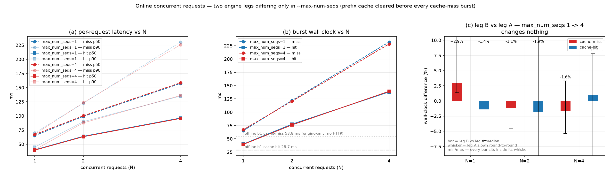
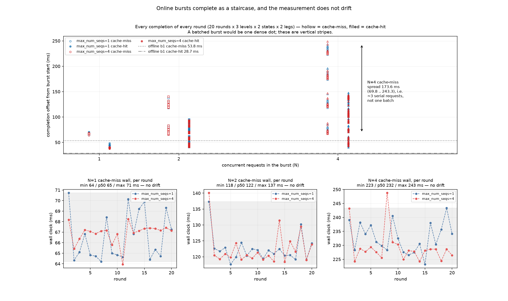
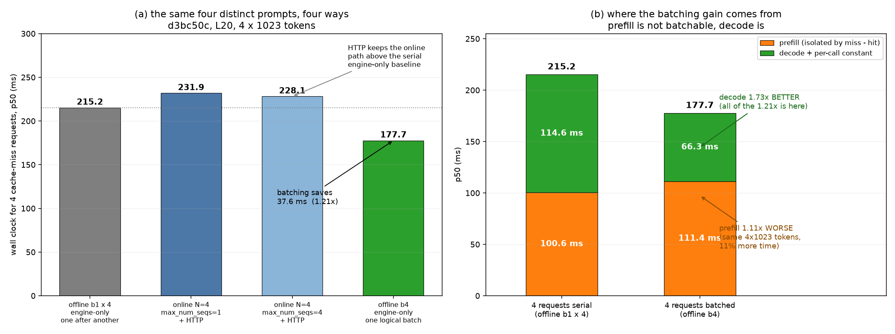

# 在线入口并发时延 vs 离线合批 — 受控对照（vllm-gr @ `d3bc50c`）

**场景：**`bw128-in1023-out3-online` beam width 128 / 输入 1023 token / 解码 3 步 / 在线 HTTP `/v1/completions` / 每轮清空前缀缓存

---

## 1. 结论

**① 四个 cache-miss 请求，同一 commit、同一张卡、同一 artifact digest：**


| 做法                                | 4 个请求做完的时间 p50 | 边界                | 单请求平均耗时 |
| ----------------------------------- | ---------------------- | ------------------- | -------------- |
| 离线 `b1 ×4`（一个接一个）          | **215.2 ms**           | engine-only         | 53.8 ms        |
| 在线 `N=4` 并发（`max_num_seqs=1`） | 231.9 ms               | + HTTP / 响应序列化 | 58.0 ms        |
| 在线 `N=4` 并发（`max_num_seqs=4`） | 228.1 ms               | + HTTP / 响应序列化 | 57.0 ms        |
| 离线 `b4`（一个逻辑批）             | **177.7 ms**           | engine-only         | **44.4 ms**    |


→ **合批比串行省 37.6 ms（1.21×）。**

**② 在线并发不产生任何加速——在线入口就是串行的。** `N=4` 并发（231.9 ms）比离线 `b1 ×4` 串行（215.2 ms）
**还慢 7.8%**：准入层强制单执行 owner，N 个请求排队跑，多出来的是 HTTP。**今天的在线路径没有收益。** 这是**设计契约**不是配置问题（`GRExecutionCapacity.active_sessions` 被 `__post_init__` 钉死为 1），
机制见 §3.4。

**③ `--max-num-seqs` 在本实验中不生效。** 两腿（1 与 4）差 ≤ 2.9%，远小于单腿自身的轮间波动（2–23%）。
原因：在线入口恒定构造 B=1 的批，`max_num_seqs` 只是一张"允许 N 个"的许可证，而没有任何东西往里填第 2 个。

**④ 合批的好处全部来自 decode，prefill 没有收益。**


| 4 个 cache-miss 请求 | prefill 段                  | decode + 每次调用常数段          | 合计       |
| ----------------- | -------------------------- | ------------------------- | -------- |
| 串行（`b1 ×4`）       | 100.6 ms                   | 114.6 ms                  | 215.2 ms |
| 合批（`b4`）          | **111.4 ms**（1.11× **变差**） | **66.3 ms**（**1.73×** 变好） | 177.7 ms |


**合批对 prefill 不省时，反而多耗时 11%**（同样 `4 × 1023` token，100.6 → 111.4 ms）。

**⑤ 对「在线链路支持多 batch」的预期：**


|            | 今天在线（实测） | 若支持合批（估） | 收益        |
| ---------- | -------- | -------- | --------- |
| cache-miss | 231.9 ms | ≈ 194 ms | **1.19×** |
| cache-hit  | 138.1 ms | ≈ 90 ms  | **1.54×** |


**假设**：engine 侧节省 1:1 迁移到在线路径；HTTP + 响应序列化不随合批减少（128×5 beam 的编码量每请求固定）。
**不确定项**：在线 async scheduling 已有约 11% 的交叠（有效单元 231.9/4 = 58 ms vs 单请求 65.2 ms）。
若这部分交叠已吃掉部分 decode 摊薄，真实收益落在 **1.05×–1.19×**。要定论必须真做出在线多 batch。

⚠️ **延长 decode 会放大合批收益，延长 prefill 会缩小它。** 本场景 `decode_steps = 3` 是 V1 硬限，
是能取到的**最小** decode 占比——所以 **1.21× 是合批收益的下界**，不是典型值。

---

## 2. 测试方法

### 2.1 要回答什么

三个问题，对应三格测量：

1. 在线 N 个并发请求，各自要多久？（在线两腿）
2. 同样的 N 个请求，一个逻辑批跑要多久？（离线 b1 / b4）
3. `--max-num-seqs` 能不能让在线合上批？（两腿对照）

### 2.2 三格设计


| 格        | 入口                                       | 一次提交的 prompt 数 | 测什么  |
| -------- | ---------------------------------------- | -------------- | ---- |
| 离线 `b1`  | `GRLLM.beam_search_v1([p], params)`      | 1              | 串行基线 |
| 离线 `b4`  | `GRLLM.beam_search_v1([p1..p4], params)` | 4              | 合批   |
| 在线 `N=k` | `POST /v1/completions` × k 并发            | k 个独立 HTTP 请求  | 在线现实 |


离线能合批的**唯一**原因是它的入口签名接 `List[Prompt]`：`_validate_batch_geometry` 只要求
`batch_size ≤ max_batch_size` 且 `≤ max_num_seqs`（`vllm_gr/v1/beam/batch_contracts.py:358-361`）。
在线入口接单个 prompt，见 §3.2。

### 2.3 请求构造：在线对齐离线


| 项                  | 做法                                                                          | 为什么                                                                      |
| ------------------ | --------------------------------------------------------------------------- | ------------------------------------------------------------------------ |
| 端点                 | `POST /v1/completions`，`prompt` = `list[int]`（1023 个 id）                    | 传 token id 时服务器完全跳过 tokenizer；chat 端点做不到固定 token 数                       |
| `custom_input_len` | `input_length - 1 = 1023`                                                   | 离线标签 `in1024` 的真实 prefill 是 1023，`begin_token` 之后内部才是 1024               |
| SID 哨兵             | `vllm_xargs = {"begin_token": "<|sid_begin|>", "end_token": "<|sid_end|>"}` | 复现离线形态                                                                   |
| `max_tokens`       | 5                                                                           | `decode_steps = 5 - 2 = 3`，正是 `CONSTRAINT_TABLE_MAX_DECODE_STEPS=3` 约束的量 |
| `n`                | 128                                                                         | 必须**严格等于**服务端 `beam.max_width`（判据是 `!=`）                                 |


回执断言：128 choices、`finish_reason = length`、`prompt_tokens = 1023`、`completion_tokens = 640`。

### 2.4 缓存协议与预热

```
每个测量轮：
  1. POST /reset_prefix_cache        ← 对齐离线 llm.reset_prefix_cache()
  2. burst(N)  → 记为 cache-miss
  3. burst(N)  → 记为 cache-hit（同一批 prompt、同一 N）
```

**前置预热**：2 个 `reset → miss → hit` 配对，然后 prompt 1..N-1 各打一次。
第一次 miss 要付全长度 prefill 的 Triton JIT，实测首轮 303 ms，次轮才 64 ms 进稳态。

> 两件事要分开：预热解决的是**编译/捕获开销**（一次性）；cache-miss / cache-hit 是**每轮都要重新摆位的缓存状态**（持续性）。

### 2.5 每个并发槽位必须使用**不同**的 prompt

这是本测量成立的前提。在线准入层（`vllm_gr/v1/engine/gr_async_scheduler.py:88-103, 106-172`）
只放行一个执行 owner，其余请求进 `waiting` 排队。因此若 N 个槽位复用一个 prompt：

```
请求 1 执行 → 它的 1023-token prefill 把该 prompt 的前缀写进 cache
请求 2..N 被放行 → 全部命中请求 1 刚写的前缀
```

发出去的 N 个请求，实测只有 **1 个 miss + (N−1) 个 hit**。拿它去比「离线的 N 个真 miss」，
比的是完全不同的工作量。

**做法**：每槽从数据集取**自己的**样本（`PROBE_DISTINCT=1`），与离线 harness 给一个逻辑批喂的
`num_prompts` 个独立样本一致。上机前用 `smoke_distinct_prompts.py` 验证（不占 GPU，秒级）：

```
dataset returned 4 samples (asked 4)
distinct lengths: [1023]
shared prefix: 3 / 1023 tokens (0.3%)
tail each later prompt must prefill after request 1: 1020 tokens
all prompts identical: False
```

**共享前缀只有 3/1023 token（0.3%）**：请求 2–4 各自仍欠约 1020 token 的真 prefill。

### 2.6 正确性判据

每槽用不同的 prompt，所以"突发内 top-1 全一致"不适用。断言改为两条：

1. **逐 prompt 稳定**：同一 prompt 在 20 轮内 top-1 不变；
2. **跨 cache 态一致**：同一 prompt 在 cache-miss 与 cache-hit 下 top-1 相同。

---

## 3. 参数配置

### 3.1 三格逐项对照


| 项                                   | 离线 `b1`                                       | 离线 `b4`            | 在线 `N=4`                     |
| ----------------------------------- | --------------------------------------------- | ------------------ | ---------------------------- |
| 代码快照                                | `source-d3bc50c`                              | 同                  | 同                            |
| 模型                                  | `OpenOneRec/OneRec-1.7B`                      | 同                  | 同                            |
| `constraint artifact_digest`        | `sha256:ebb47726a…62c8e`                      | 同                  | 同                            |
| `beam_width` / `max_logprobs` / `n` | 128                                           | 128                | 128                          |
| 输入 token / `max_tokens`             | 1023 / 5                                      | 1023 / 5           | 1023 / 5                     |
| `prefill_graph_kv_bound`            | 4096                                          | 4096               | 4096                         |
| `max_num_seqs`                      | 1                                             | 4                  | 1 / 4（两腿）                    |
| `single_request`                    | `True`                                        | `False`            | —（入口恒 B=1）                   |
| 每请求 prompt                          | 独立                                            | 独立                 | **独立**                       |
| 采样单元                                | logical-batch × 100                           | logical-batch × 25 | burst × 20 轮 × 3 档           |
| **E2E 边界**                          | engine-only                                   | engine-only        | **含 HTTP + 128×5 beam 响应编码** |
| 硬件                                  | L20（GPU1），容器 `vllm-gr-benchmark-gpu1`，端口 8199 | 同                  | 同                            |


> ⚠️ **E2E 边界是三格之间唯一的不可比项。** 在线多买一项 HTTP + 序列化，
> 实测 N=1 时 cache-miss 多 **+11.4 ms**（腿 A）/ **+13.3 ms**（腿 B），cache-hit 多 **+11.3 / +10.8 ms**。
> 任何并排比较都必须先声明这个边界，§5 的估算专门处理它。

### 3.2 `--max-num-seqs` 在本实验中不生效

**这个参数是什么。** 它是 vLLM 调度器的**配额**：一个调度步里最多允许几个序列在跑。三处作用——


| 作用                                         | 位置                                                                                                                                 |
| ------------------------------------------ | ---------------------------------------------------------------------------------------------------------------------------------- |
| `batch_size` 的硬上界（两条独立的界都要过）               | `vllm_gr/v1/beam/batch_contracts.py:358-361`                                                                                       |
| 预分配**固定地址** metadata 缓冲（CUDA graph 要求地址稳定） | `vllm_gr/v1/attention/backends/beam_attn_metadata.py:309`（`max_reqs = max_num_seqs`）、`:322`（`max_segs = max_reqs * max_beams + 1`） |
| CUDA graph 捕获尺寸                            | 实测两腿 `[1, 2]` vs `[1, 2, 4, 8]`                                                                                                    |


**它不负责把 N 个塞进去。** 这句话就写在源码里，作为类的 docstring：

```python
class GRExecutionCapacity:
    """Shared Asynchronous scheduling admission contract; storage capacity does not enable concurrency."""
    active_sessions: int = 1
```

`active_sessions != 1` 直接抛 `"Asynchronous scheduling requires one execution owner and two dispatch slots"`。

**在线卡在哪：B=1 被五层显式拒绝**（行号取自本地 HEAD `42e633b`，领先 `d3bc50c` 16 个提交，五处形状未变）：


| 层               | 位置                                                  | 消息                                                     |
| --------------- | --------------------------------------------------- | ------------------------------------------------------ |
| 在线 HTTP 请求解析    | `entrypoints/beam_search_v1/input_processor.py:117` | `beam_search_v1 currently requires exactly one prompt` |
| 会话构造            | `v1/engine/beam_search_v1.py:186`                   | `Beam Search V1 currently requires batch size B=1`     |
| 引擎核心            | `v1/engine/core.py:250`                             | 同上                                                     |
| 准入              | `v1/engine/gr_async_scheduler.py:245`               | 同上（`GRAdmissionError`）                                 |
| worker stage 校验 | `v1/worker/gpu_beam_stage_runner.py:187`            | 校验 `len(request.items) != 1`                           |


**实测后果**（见 §4.1 图 1c）：两腿墙钟差 ≤ 2.9%，且每个差值的误差棒都比它自己长。
两腿的 `/metrics` `num_requests_running` **都恒为 1.0**，`num_requests_waiting` **都恒为 N−1**。

**腿 B 唯一的实际代价**（全部是启动期，零运行时收益）：


|                             | 腿 A            | 腿 B                            |
| --------------------------- | -------------- | ------------------------------ |
| `cudagraph_capture_sizes`   | `[1, 2]`       | `[1, 2, 4, 8]`（多捕获 2 张永不被回放的图） |
| `Available KV cache memory` | 16.88 GiB      | 16.85 GiB                      |
| `GPU KV cache size`         | 158,032 tokens | 157,760 tokens                 |


> 完整 engine config 行逐字符比对：**3370 个字符里只有 8 个不同**，全部来自上面两个派生字段。

**结论**：`max_num_seqs` 调的是**容量**，那五处守卫拦的是**入口**。要在线的批形成，缺的不是这个参数。

### 3.3 澄清：「并行」在这个系统里有三个不同的意思


| 名字                 | 指什么                         | 谁在管                                          | 在线开着吗      |
| ------------------ | --------------------------- | -------------------------------------------- | ---------- |
| **批内并行**（batching） | 一个 forward 里同时算 N 个**不同请求** | `max_num_seqs` + `max_batch_size`            | ❌ 入口恒 B=1  |
| **beam 内并行**       | 一个请求内部 128 条 beam 一起算       | `--max-logprobs` / config 的 `beam_max_width` | ✅ 一直开着     |
| **请求间并发**          | N 个 HTTP 请求同时在飞             | 服务端收得下，引擎里排队跑                                | ⚠️ 收得下，不并行 |


从缓冲形状看得最清楚：`max_segs = max_reqs × max_beams`。**一个请求就已经用掉 `1 × 128 = 128` 路 beam。**
`max_num_seqs` 管的是公式里**外面那个乘数**，不是里面那个。腿 B 把它给到 4，但入口仍只交 1 个请求进来，
乘出来还是 `1 × 128`。

### 3.4 在线为什么是串行的：单 owner 准入

**当前在线入口就是串行处理请求的**——不是因为服务端收不下，而是**准入层每一步只放行一个执行 owner**。
两处机制，都在 `vllm_gr/v1/engine/gr_async_scheduler.py`：

**① 挑 owner（`:78-93`）**——已有 owner 就直接返回它，否则按 FIFO 取第一个 `WAITING` 的会话：

```python
def _admit_owner(scheduler):
    owner_id = getattr(scheduler, "_gr_owner", None)
    if owner_id is not None:
        return sessions[owner_id]          # 已有 owner → 只返回它，别人不参与
    for session in sessions.values():      # 否则按 FIFO 取第一个 WAITING 的当 owner
        if session.resource_status is GRResourceStatus.WAITING:
            scheduler._gr_owner = session.session_id
            session.resource_status = GRResourceStatus.RUNNING
            return session
    return None
```

**② 把队列蒙上（`:96-120`）**——`gr_admission` 每个调度步把这个 wrapper 装到 `scheduler.waiting` 上：

```python
class _AdmissionQueue:
    """Filtered native queue: hidden requests retain their objects and FIFO positions."""
    def __iter__(self):
        return (r for r in self.queue if r.request_id == self.owner_id)
```

于是 **native 调度器只看得见 owner 一个请求**：请求 2..N 保留在底层队列里（FIFO 位置不变），但对选择循环不可见。
N 个 HTTP 请求的稳态就是 **1 个 RUNNING + (N−1) 个 WAITING**，一个跑完才轮到下一个。
这正是 §4.1 的 `/metrics` 读数和 §4.2 的阶梯形状的来源。

**这不是漏改的开关，是声明过的契约。** `GRExecutionCapacity` 的 docstring 写着
*"storage capacity does not enable concurrency"*，`active_sessions` 被 `__post_init__` 钉死为 `1`
（`!= 1` 直接抛异常，**根本构造不出别的值**）。但运行时没有任何代码读这个字段——
**它记录的是意图，真正执行的是上面的队列过滤。**

**支撑它的还有三条"单请求独占"的结构假设**（这三处比那五层守卫难改，因为它们是设计前提，不是校验）：


| #   | 结构假设                                              | 位置                                                                          |
| --- | ------------------------------------------------- | --------------------------------------------------------------------------- |
| 1   | 请求一进来就把 `prefill + 全部 decode` 的 KV **整段预留**       | `gr_async_scheduler.py:139`：`extent = num_prompt_tokens + max_decode_steps` |
| 2   | 非 owner 一碰 KV 分配就 `RuntimeError`                  | 同函数 `:136-137`：`"allocation escaped the execution owner"`                   |
| 3   | CUDA graph 缓冲地址按 `max_reqs × max_beams` **启动时定死** | `beam_attn_metadata.py:309, :322`                                           |


> ⚠️ **与那五层 `len(items) != 1` 守卫是两个独立机制，别混为一谈。**
> 五层守卫拦的是「一个请求里塞多个 prompt」——**即使把它们全删掉，请求 2 仍会留在 `waiting`**
> （因为 `_AdmissionQueue` 看不见它）；反过来只改准入层，得到的是 N 个会话轮流占时间片，
> 而不是一个合批的 forward。`**max_num_seqs` 对两者都不起作用。**

---

## 4. 结果与分析

### 4.1 在线并发时延


| 腿            | N   | miss p50 | miss p90 | miss p99 | hit p50 | hit p90 | hit p99 | miss 墙钟 p50 | hit 墙钟 p50 |
| ------------ | --- | -------- | -------- | -------- | ------- | ------- | ------- | ----------- | ---------- |
| A (`seqs=1`) | 1   | **65.2** | 69.9     | 70.6     | 40.0    | 44.9    | 47.5    | 65.2        | 40.0       |
| A            | 2   | 99.2     | 122.5    | 133.3    | 63.9    | 89.8    | 92.5    | 121.9       | 77.4       |
| A            | 4   | 157.3    | 230.5    | 238.4    | 96.3    | 135.0   | 141.2   | **231.9**   | 138.1      |
| B (`seqs=4`) | 1   | **67.1** | 67.5     | 68.2     | 39.5    | 40.2    | 40.5    | 67.1        | 39.5       |
| B            | 2   | 100.2    | 123.3    | 135.5    | 63.3    | 87.7    | 91.2    | 120.5       | 75.9       |
| B            | 4   | 158.6    | 225.8    | 243.5    | 95.6    | 136.1   | 139.9   | **228.1**   | 139.3      |


每格 20 个 miss/hit 配对，per-request 分位为 20×N 个样本。



**图 1 怎么读**

- **(a) 每请求时延 vs N** — 4 条实线（两腿 × miss/hit 的 p50）+ 4 条淡线（对应 p90）。N 轴是 `1, 2, 4`。
读法：**miss 线与 hit 线的垂直间距就是 1023-token prefill 的成本**，它在 N=1 时是 25 ms，到 N=4 涨到 61 ms。
- **(b) 突发墙钟 vs N** — 同样 4 条线，两条灰色横线是**离线 b1 单请求**的 cache-miss（53.8）与 cache-hit（28.7），
即"没有任何 HTTP"的位置。读法：**在线曲线与灰线的垂直间距就是 HTTP 边界的代价**；两条在线线几乎完全重合。
- **(c) 腿 B vs 腿 A** — 柱子是腿 B 相对腿 A 的墙钟中位数差（%），**误差棒是腿 A 自己 20 轮的 min/max 波动**。
读法：**每一根误差棒都比它包着的柱子长**——腿间差完全被单腿自身的轮间波动吞掉。

**从图 1 得到的结论**

1. **(c) 是 `--max-num-seqs` 无效的直接证据**：6 个差值为 `+2.9 / −1.4 / −1.1 / −1.9 / −1.6 / +0.9 %`，
  全部 ≤ 2.9%；而腿 A 自身的轮间波动是 **2–23%**（如 N=2 的 hit 墙钟分布在 68.1–94.9 ms，即 `+23% / −12%`）。
   **腿间差比腿内噪声小一个量级。**
2. **(b) 的斜率**：miss 墙钟从 65.2 → 121.9 → 231.9，对 N 的比值是 `65.2 / 61.0 / 58.0` ms 每请求——
  **接近完全串行（4× 会是 260.8 ms），只留约 11% 的交叠**。这部分交叠来自 async scheduling 在
   请求切换时填的缝，不是合批。
3. **(b) 中在线曲线整体在离线灰线之上**，N=1 miss 高出 11.4 ms / 13.3 ms——这就是 HTTP + 响应序列化的代价，
  与离线口径明确排除的那一项吻合。

### 4.2 完成形状：阶梯，不是聚簇



**图 2 怎么读**

- **上半**：每一次请求的**完成时刻相对突发起点的偏移**。横轴是突发里的并发数 N（`1/2/4`，miss 与 hit 各带 ±0.13 的横向错开），
纵轴是毫秒。空心 = cache-miss 突发，实心 = cache-hit 突发，两种颜色 = 两条腿。
画了**全部 20 轮 × 3 档 × 2 态 × 2 腿**的每一个点，没有抽样。两条灰线是离线 b1 的位置。
- **下半**：三个小图分别是 N=1/2/4 的**逐轮 cache-miss 墙钟**，两条线是两腿，灰色带是腿 A 的 min–max 区间。

**从图 2 得到的结论**

1. **上半：每一列都是竖条，不是点。** 如果请求被合批，同一档的所有点会挤在同一个 y 值附近（一个致密的点）。
  实测是**竖直条纹**——每个请求在不同的时刻完成。
2. **N=4 cache-miss 的条纹跨度 173.6 ms**（实测最早 69.8 ms、最晚 243.3 ms）。
  **173.6 ms ≈ 3 个单请求的时间（`3 × 58 = 174`），而不是一个批的时间**——
   这就是 §3.4 所述单 owner 串行最直白的视觉证据，也是 `max_num_seqs` 无效的第三重印证。
3. **所有点都远在灰线（离线 b1 53.8 / 28.7 ms）之上**，包括最早完成的那个请求（N=4 miss 的 min 是 69.8 ms）。
  即**没有任何一个请求享受到离线单请求的时延**——每个都在等前面的。
4. **下半：20 轮没有漂移。** 三条带子的 min/p50/max 分别是 `64/65/71`、`118/122/137`、`223/232/243` ms，
  两条腿**逐轮交替领先**、无系统性偏移。这支持 §4.1 的结论：腿间差是噪声，不是效应。

### 4.3 离线 b1 / b4 基线（同一 commit）


| 格    | `max_num_seqs` | `single_request` | 批数      | cache-miss p50 (min–max) | cache-hit p50 (min–max) |
| ---- | -------------- | ---------------- | ------- | ------------------------ | ----------------------- |
| `b1` | 1              | `True`           | 100 × 1 | **53.8** (53.6–55.0)     | **28.7** (28.6–29.1)    |
| `b4` | 4              | `False`          | 25 × 4  | **177.7** (176.2–178.2)  | **66.3** (66.1–72.9)    |


σ 极小（`b1` miss 0.21 ms，`b4` miss 0.75 ms），三格 `artifact_digest` 完全相同。
**注意第二列**：这里 `max_num_seqs` 从 1 变到 4 是**真的起作用了**（`single_request` 随之 True→False），
因为离线入口能一次提交 4 个 prompt——与 §3.2 在线的情形正好构成对照。

### 4.4 受控对照：四个 cache-miss 请求



**图 3 怎么读**

- **(a)** 四个柱 = 同一批 4 个 1023-token 独立 prompt，四种做法的墙钟 p50。灰色虚线 = 离线串行基线。
灰色柱与绿色柱都是 **engine-only**（离线口径），蓝色两柱**含 HTTP**。图上的箭头标出了两个差值。
- **(b)** 把 (a) 的两个 **engine-only** 柱拆开。拆分方法是 `miss − hit`：
同一种 cache 状态下 decode 和调用常数**完全相同**，所以 `miss 的 p50 − hit 的 p50` 恰好剥离出
1023-token 的 prefill 成本。橙色 = 剥离出的 prefill，绿色 = 剩下的 decode + 每次调用的常数开销。

**从图 3(a) 得到的结论**


| 对比                        | 差值                  | 含义                                                                |
| ------------------------- | ------------------- | ----------------------------------------------------------------- |
| 离线串行 215.2 → 离线合批 177.7   | **−37.6 ms（1.21×）** | 合批本身的价值（engine-only，同口径）                                          |
| 离线串行 215.2 → 在线 N=4 231.9 | **+16.7 ms（+7.8%）** | **在线并发比离线串行还慢**——HTTP 边界按 §3.1 是 +11.4 ms/请求，被交叠抵消一部分后净剩 +16.7 ms |
| 在线腿 A 231.9 → 在线腿 B 228.1 | −3.8 ms（−1.6%）      | `max_num_seqs` 无效（见 §3.2）                                         |


**关键读数**：在线两柱都**高于**离线串行的灰虚线。这说明在线路径不仅没拿到合批收益，
其并发机制本身也没有产生任何加速——`active_sessions = 1` 让它退化成"排队 + HTTP 税"。

**从图 3(b) 得到的结论**


|                          | 串行                      | 合批         | 倍数           |
| ------------------------ | ----------------------- | ---------- | ------------ |
| prefill（`miss − hit` 剥离） | `100.6 ms`（`4 × 25.15`） | `111.4 ms` | **1.11× 变差** |
| decode + 调用常数            | `114.6 ms`              | `66.3 ms`  | **1.73× 变好** |
| 合计                       | 215.2 ms                | 177.7 ms   | 1.21×        |


1. **prefill 不可批，而且合批让它变贵。** 同样 4 个 1023-token 请求的 prefill，
  串行 `100.6 ms`、合批 `111.4 ms`，**1.11× 变差**——token 数一模一样（`4 × 1023`），
   时间却多了 11%。**合批让 prefill 每 token 贵 11%**：4 个 1023-token 的 prefill 合进一个 forward，
   总 FLOPs 一样多，形状变大没有换来任何效率。
2. **1.21× 全部来自绿色块**。decode 段（含每次调用的固定开销被摊薄）从 114.6 降到 66.3。
3. **推论：decode 占比越高，合批越值。** cache-hit 下请求几乎全是 decode，所以那里的收益更大——
  用同样两个数验证：`b1 hit ×4 = 114.6 ms` vs `b4 hit = 66.3 ms` = **1.73×**，与上表绿色倍数完全吻合。
   本场景 `decode_steps = 3` 是 V1 硬限，是能取到的**最小** decode 占比，所以 **1.21× 是下界**。

### 4.5 正确性

两腿均：`problems = 0`、`tops_stable = True`、`distinct_prompts = True`、`prompt_count = 4`、
`shared_prefix_tokens = 3`。每请求 128 choices、`finish_reason = length`、
`prompt_tokens = 1023`、`completion_tokens = 640`；
**每个 prompt 的 top-1 在 20 轮内稳定，且 cache-miss 与 cache-hit 两条路径给出同一个 top-1（4/4 一致）**。

server log：`0 traceback`、`0 admission_rejected`、`0 mode-guard`。
17 条 JIT 告警全部集中在引擎启动后同一秒内（第 111–129 行），**不在任何测量轮里**。

---

## 5. 在线支持多 batch 的价值

按 §3.1 声明的边界，把离线测到的 **engine 侧节省**平移到在线墙钟上：


|            | 今天在线（实测） | 若支持合批（估）                  | 收益        |
| ---------- | -------- | ------------------------- | --------- |
| cache-miss | 231.9 ms | `231.9 − 37.5 = 194.4 ms` | **1.19×** |
| cache-hit  | 138.1 ms | `138.1 − 48.3 = 89.8 ms`  | **1.54×** |


其中 `37.5 = 215.2 − 177.7`、`48.3 = 114.6 − 66.3`，都是离线实测差（§4.4）。

**两条假设**：

1. engine 侧节省 1:1 迁移到在线路径（同一 engine、同一 B、同一批 prompt）；
2. HTTP + 响应序列化**不随合批减少**——每请求仍要编码 128×5 beam，所以省不掉。

**不确定性**：在线 async scheduling 已经提供了约 11% 的交叠（§4.1(b)）。如果这部分交叠本就已经
吃掉了部分 decode 摊薄收益，真实值会更低，落到 **1.05×–1.19×**。**要定论必须真做出在线多 batch。**

**要改什么**（`max_num_seqs` 不在清单里，它已就位）：

1. 五处 `len(request.items) != 1` 守卫（入口那处是 `input_processor.py:117`）；
2. 准入层 `active_sessions = 1` → N（否则第二个请求进不来）；
3. 服务端把一次 HTTP 请求里的 N 个 prompt 组装成**一个** `BeamBatchRequest`，而不是 N 个 B=1 的会话。

---

## 6. 复现

```bash
# 0) 上机前的无 GPU 冒烟：确认数据集能给 N 个独立等长 prompt（秒级）
docker exec -w /tmp -e "PYTHONPATH=$SNAP" -e "SNAP=$SNAP" -e PROBE_COUNT=4 \
  "$C" python3 results/soak-online/smoke_distinct_prompts.py

# 1) 在线两腿（distinct prompts + paired 缓存协议）
cd ~/vllm-gr-decode-graph
PROBE_LEVELS=1,2,4 PROBE_ROUNDS=20 PROBE_INPUT_LEN=1024 PROBE_ALIGN_OFFLINE=1 \
  PROBE_EXPECT_TOKENS=640 PROBE_PAIRED=1 PROBE_DISTINCT=1 RUN_TAG=-paired-distinct \
  nohup bash results/soak-online/stage-concurrency.sh > results/soak-online/paired-distinct.out 2>&1 </dev/null &

# 2) 同 commit 的离线 b1 / b4
nohup bash results/soak-online/run_offline_pair.sh d3bc50c 100 0 \
  > results/soak-online/offline-pair.out 2>&1 </dev/null &

# 3) 出图（图 1/2/3 全部由原始 JSON 生成，不会与报告数字脱节）
python3 results/soak-online/make_figs.py <online_dir> <b1.json> <b4.json> <out_dir>
```


| 脚本                             | 作用                                                                                                                              |
| ------------------------------ | ------------------------------------------------------------------------------------------------------------------------------- |
| `probe_concurrency_latency.py` | 并发探针。env：`PROBE_LEVELS/ROUNDS/METRICS/OUT/INPUT_LEN/ALIGN_OFFLINE/EXPECT_TOKENS/PAIRED/WARMUP_PAIRS/DISTINCT`                   |
| `stage-concurrency.sh`         | 两腿驱动（`LEGS=1` 只跑单腿做冒烟）；复用 `stage23.sh` 的 `serve_pids/wait_health/stop_leg/launch`                                               |
| `smoke_distinct_prompts.py`    | 无 GPU 验证数据集能给 N 个独立等长 prompt                                                                                                    |
| `run_offline_pair.sh`          | 同 commit 跑离线 b1/b4。引擎代码取自 `PYTHONPATH=$SNAP`；驱动脚本取自 worktree，因为 `tools/daily_benchmark/` 在服务器上 untracked，不在任何 `git archive` 快照里 |
| `make_figs.py`                 | 图 1/2/3 的**唯一**生成器，全部从原始 JSON 读                                                                                                 |
| `analyze_paired.py`            | 控制台数字汇总（含逐轮墙钟稳定性检查）                                                                                                             |
| `analyze_controlled.py`        | §4.4 受控对照表与控制台打印                                                                                                                |


**原始产物**：`raw-distinct/`（两腿 JSON、两腿 server log、两轮离线 raw JSON、全部脚本）。
`**raw-superseded-single-prompt/**` 是作废的一轮，内含 README 说明为何不可引用——保留只为留痕。

---

## 7. 遗留


| #   | 项                         | 说明                                                                                                                                                                                                        |
| --- | ------------------------- | --------------------------------------------------------------------------------------------------------------------------------------------------------------------------------------------------------- |
| 1   | **离线阶段分解缺失**              | `tools/daily_benchmark/run_offline_benchmark.py`（worktree 版）的 diagnostic 路径与 `d3bc50c` 引擎签名不匹配，抛 `TypeError`。故离线跑用 `--diagnostic-prompts 0`。§4.4 的 prefill 是用 `miss − hit` **推导**的，推导只依赖两个 e2el p50，结论稳健。 |
| 2   | **腿 A 的 cache-hit 双峰未归因** | 腿 A（`max_num_seqs=1`）N=1 cache-hit 一半落在 ~39.5 ms、一半落在 ~44.5 ms；非漂移（前半中位 40.5 / 后半 39.9）。腿 B 的 hit 与两腿的 miss 都紧致。**腿 A 的 hit 数字不可用于下结论**，§4 的分析都基于 miss 或腿 B。                                              |
| 3   | **§5 是在线搬移估算**            | 不是实测。真值需做出在线多 batch 才能定。区间 **1.05×–1.19×**（miss）。                                                                                                                                                         |
| 4   | **腿序未反转**                 | 两腿顺序执行（腿 A 07:27 起、腿 B 07:29 起），无 A-B-B-A。§4.1(c) 的误差棒是为覆盖这一点而画的。                                                                                                                                         |
| 5   | `**max_tokens` 天花板 3**    | V1 硬限。这压缩了交叠观测窗口，也使 decode 占比取到最小值——所以 §4.4 的 1.21× 是下界。                                                                                                                                                  |

