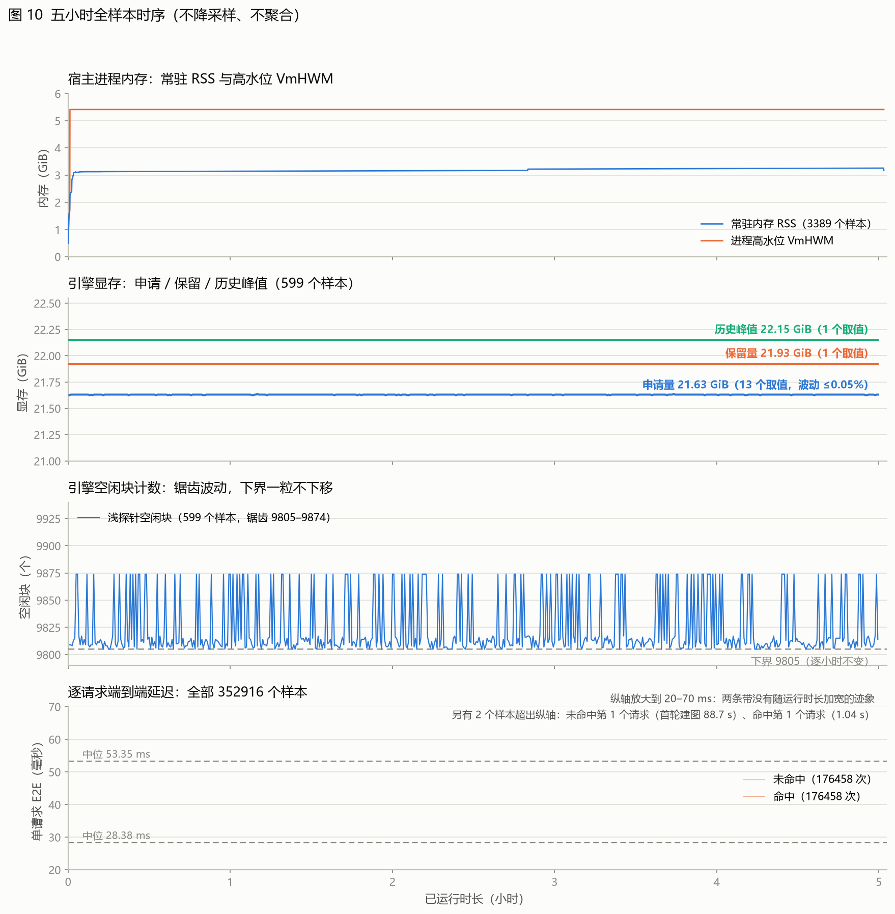
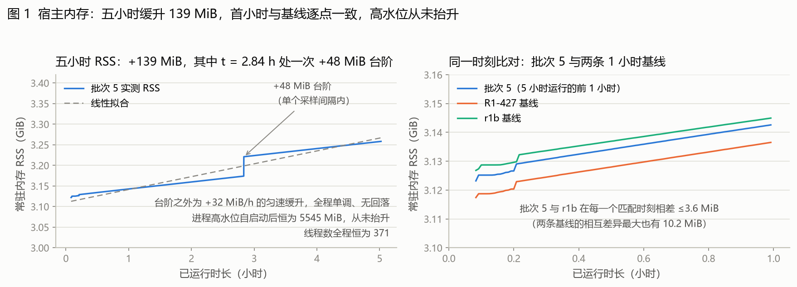
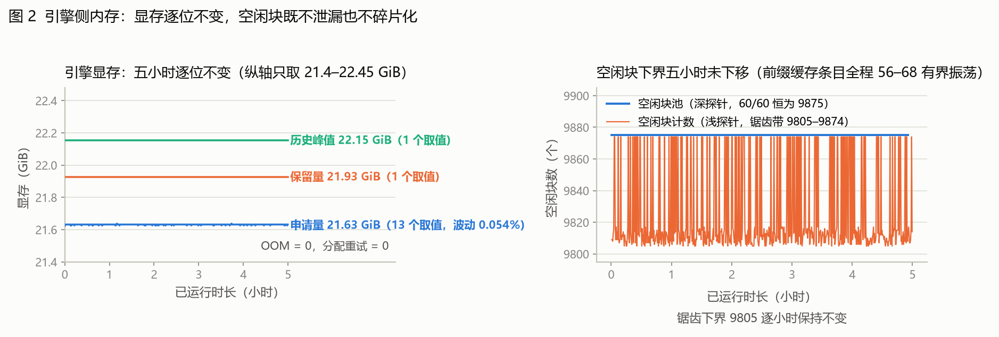
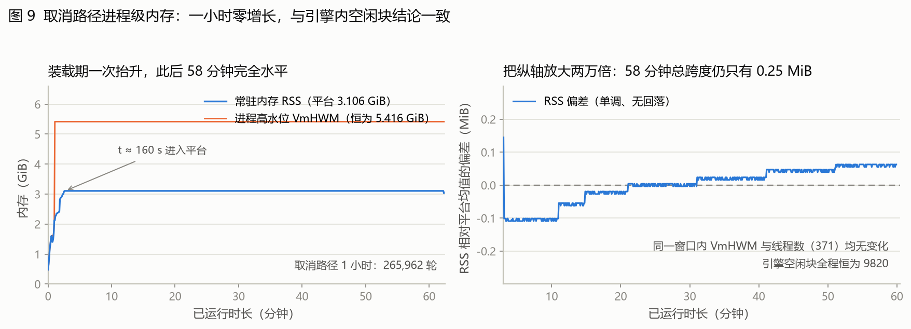
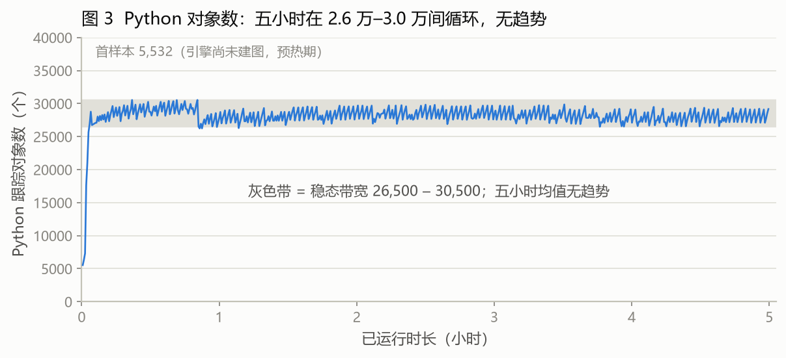
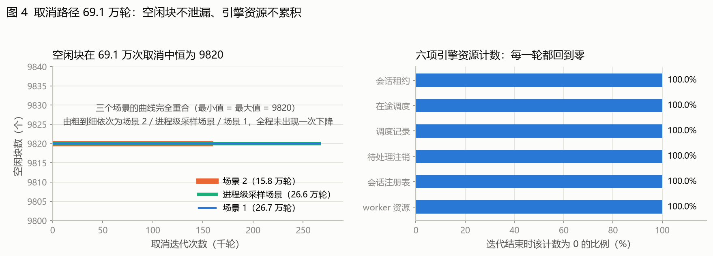
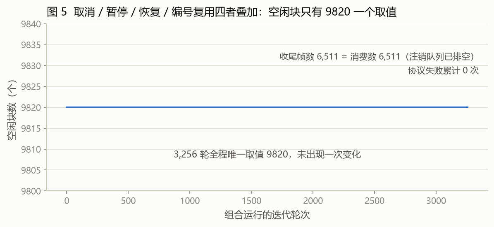
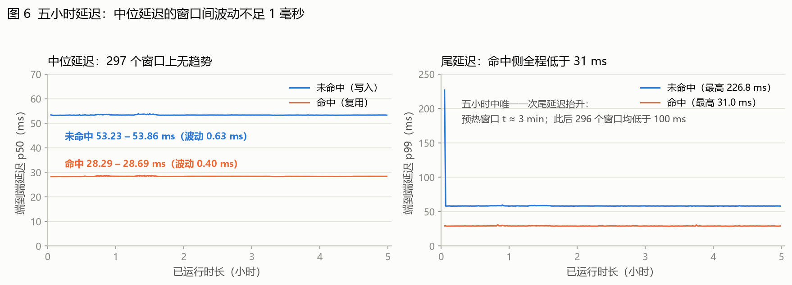
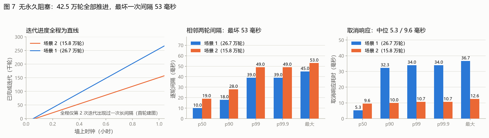
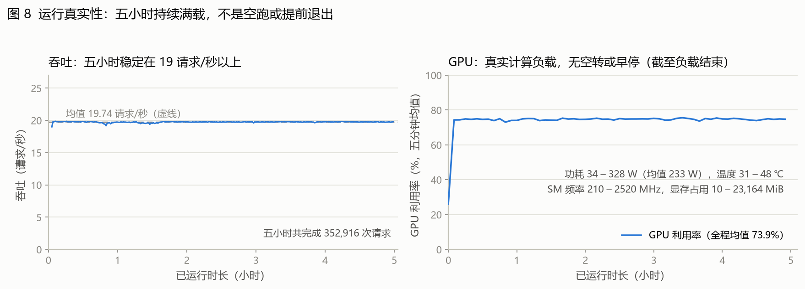

# vllm-gr `beam_search_v1` 会话生命周期长跑稳定性验证报告

当前源码快照下，`beam_search_v1` 的会话生命周期链路（取消、暂停与恢复、会话编号跨次复用）在 OneRec 顺序
请求负载上累计执行 **1,408,640 次取消**、**334,152 次暂停**与 **6,510 次会话编号跨次复用**，另完成
**352,916 次正常请求**；单次最长连续运行 **5.00 小时**。剔除装载与预热后（t ≥ 300 s，各 174,733 个样本），
**只有 1 次**端到端延迟超过 100 ms（未命中第 98,348 个请求，运行第 2.80 小时）；其余 203 次超过 100 ms
的样本全部落在装载与预热的前 245 秒内。

结论是：**未观察到内存泄漏、空闲块泄漏、永久阻塞、逐轮资源累积或输出漂移。** 引擎侧显存与空闲块池在
五小时内取值不变；140.9 万次取消全部推进，六项引擎资源计数在每一轮结束时都回到零；35 万个请求的输出
数值摘要逐位一致。

这里的"未观察到缺陷"是本次模型、负载、配置与规模下的观测结论，不等于在所有负载、并发条件和无限运行
时间下都不存在延迟波动或缺陷。本次全部为**离线、进程内调用、并发恒为 1**，未覆盖在线 HTTP 路径、
并发排队与抢占；内核层 Xid 通道因非 root 不可读而为空，是本次唯一的观测盲区。逐项未覆盖范围见 §10。

---

## 1. 测试目的：要回答什么问题

`beam_search_v1` 的会话生命周期里有四条路径只在异常时序下才会被走到：**取消**、**暂停与恢复**、
**会话编号跨次复用**，以及这几者的两两叠加。常规基准测试只跑「提交 → 等待完成」这一条正常路径，
上述路径既不会被触发，出问题时也不会体现在吞吐或延迟数字上。

本阶段要回答的是：**这些路径在长时间反复执行后，会不会让引擎慢慢泄漏、让前缀缓存失效、让状态机永久
卡死，或者让输出在无人察觉的情况下算错。**

三类失效的暴露方式完全不同，因此需要不同的观测手段：

| 失效类型 | 表现 | 只能靠什么发现 |
|---|---|---|
| 崩溃、OOM、CUDA 错误 | 进程直接退出 | 长跑本身即可暴露 |
| 资源泄漏、状态卡死 | 进程还活着，但越来越慢，或某条路径再也不能用 | 逐轮比对引擎内部计数与空闲块 |
| **静默算错** | 进程健康、延迟正常，只有输出变了 | 逐请求的数值指纹比对 |

第三类是本次的主要目标。此前的工作只测了延迟与吞吐，没有覆盖「同样的输入是否仍然产出同样的输出」。

## 2. 测试设置

### 2.1 运行方式与适用范围

| 项 | 取值 | 为什么这样取 |
|---|---|---|
| **调用方式** | **离线**，进程内直接构造 `GRLLM` 并调用 `beam_search_v1` | 不经过 HTTP 服务，排除 API Server、请求序列化与网络栈的干扰，使观测到的状态归因于引擎本身 |
| **进程模型** | 批次 2、5 **单进程**（`VLLM_ENABLE_V1_MULTIPROCESSING=0`）；批次 3、4 **多进程**（生产口径） | 单进程下探针能直接遍历引擎内存对象，取到最完整的内部状态；批次 3、4 针对的暂停与组合路径只在多进程下才有意义，必须在生产口径下跑 |
| **并发** | **1**，严格串行：发出一个请求 → 等它完全结束 → 才发下一个；`max_num_seqs=1` | 本次只测「单请求长时间反复通过同一套生命周期代码后是否累积出状态」，不测排队与调度竞争。任何时刻在途请求不超过 1 个 |

并发 1 是本次的**适用范围，不是省略项**；多并发下的调度行为需要另行设计实验。

### 2.2 模型与引擎参数

| 参数 | 取值 |
|---|---|
| 模型 | `OpenOneRec/OneRec-1.7B`（解析为 `Qwen3ForCausalLM`，bf16） |
| 权重 / 引擎初始化 | 3.31 GiB / 68.92 s（其中 `torch.compile` 40.03 s） |
| 主机与设备 | 主机 `10018`，容器 `vllm-gr-benchmark-gpu1`，单卡 NVIDIA L20，`tensor_parallel_size=1` |
| `max_num_seqs` | 1 |
| `max_num_batched_tokens` / `max_model_len` | 40960 / 40960 |
| `enable_chunked_prefill` / `enable_prefix_caching` | `False` / `True` |
| `scheduling_policy` / `async_scheduling` | `fcfs` / `True` |
| `gpu_memory_utilization` / `max_logprobs` | 0.5 / 128 |
| KV cache | 158,000 tokens（block size 16） |
| 计算图 | CUDA graph 已捕获：66 个 prefill bucket + 2 个分段 + 1 个完全模式 |
| 模型执行器 | `VLLM_USE_V2_MODEL_RUNNER=0`（固定使用 V1） |
| 预填充图 KV 上界 | `VLLM_GR_PREFILL_GRAPH_KV_BOUND=4096` |

### 2.3 负载形状与设计意图

| 参数 | 取值 | 设计意图 |
|---|---|---|
| beam 宽度 | 128 | 走 `beam_search_v1` 的完整逻辑 |
| 输入长度 | **900–1100 随机** | block size 为 16 时，命中缓存的请求只调度未缓存的那一小段（`((L-1) % 16) + 1`），因此扫过长度就是扫过 1..16 的全部尾部形状，同时覆盖 1024 / 1152 两个计算图分桶及其边界 |
| prompt 池 | 64 条，确定性循环 | 结合 `temperature=0`，同一个 `(提示词, 长度, 命中/未命中)` 组合**必须逐位产出同样的结果**，于是长跑自带数十万次自洽性比对，且不额外增加开销 |
| 请求对 | 未命中 + 命中交替 | 每次未命中都构造一次真实的前缀缓存写入，命中则验证写入结果可被复用 |
| 前缀缓存重置 | 每 10 轮一次，且只在引擎完全静置时执行 | 实测跳过 0 次 |

### 2.4 观测手段与判据

**被测进程自己不能当观测者。** 宿主侧监视程序、容器内驱动脚本与被测引擎是三个独立进程；除监视程序的
常规采集（GPU 利用率/功耗/时钟/降频位、`/proc/<pid>` 的内存与线程数、宿主负载）外，另有两路进程内探针：

- **浅路**：每 30 秒一次，55 个字段（CUDA 显存三档、GC 各代对象数、空闲块计数、引擎资源计数）；
- **深走查**：每约 300 秒一次，438 个字段，**遍历引擎对象图中所有可达容器的长度**——因此能捕获按名字
  没有预测到的累积量，而不是只看已知的几个计数器。

判据分两档：**否决性判据**（任一条不满足即判该场景失败，进程返回码非零）检查「会话注册表无 `ABORTED`
残留、六项资源计数归零、`reset_prefix_cache()` 未返回过 `False`、无永久挂死」；
**参考性判据**（记录但不导致失败）检查「空闲块与本次运行基线逐位相等、探针读取无错误」。

## 3. 测试批次与执行

### 3.1 批次规模

| 批次 | 覆盖路径 | 进程模型 | 规模 | 结果 |
|---|---|---|---|---|
| 1 | 探针基础设施自检 | 单 / 多 | 23 项自检 + 两次 30 分钟双模式验证 | 通过：两种模式读出同一组字段 |
| 2 | 取消路径反复执行 | 单 | **7 个场景**（含 1 个同时采集进程级内存），**1,408,640 次**取消 | 通过：无残留、无缓存失效、无空闲块泄漏、无阻塞 |
| 3 | 暂停与恢复长跑 | 多 | 7 次运行 5 小时，**339,616 轮** / **334,152 次**暂停 | 通过：无一次暂停未返回、无一次会话滞留 |
| 4 | 取消 + 暂停 + 同号复用 + 前缀缓存叠加 | 多 | 1 次运行 2 小时，3,256 轮 / **6,510 次**同号复用 | 通过：批次 2、3 的判据同时成立，无新失效 |
| 5 | 纯正常请求稳态基线 | 单 | 5 小时，**352,916 次**请求 | 通过；软失败判据触发 5 条，逐条归因后为检测器假阳性或与基线同形 |

批次 2 的七个场景覆盖三个调度窗口（取消点几何）、终端分支选择、幂等契约与编号复用，其中三个长场景各
1 小时、三个短场景各 10 分钟。批次 1 更换过探针与进程定位方式（原方案在多进程下会静默返回空值），
因此批次 5 用新口径完整跑满五小时，证明前面各批的结论不是观测方式变出来的。

### 3.2 执行时间（UTC）

| 批次 | 运行 | 开始 | 结束 | 墙钟 |
|---|---|---|---|---|
| 1 | 双模式 30 分钟验证 · 单进程 | 2026-10-08T03:09:44Z | 2026-10-08T03:41:22Z | 31.6 min |
| 1 | 双模式 30 分钟验证 · 多进程 | 2026-10-08T04:20:58Z | 2026-10-08T04:53:03Z | 32.1 min |
| 2 | 取消路径六场景（3 个各 1 h + 3 个各 10 min） | 2026-10-08T06:54:02Z | 2026-10-08T10:39:14Z | 3.75 h |
| 2 | 取消路径 1 小时运行（同时采集进程级内存） | 2026-10-13T03:26:41Z | 2026-10-13T04:29:13Z | 62.5 min |
| 3 | 暂停五场景扫描（各 1 h） | 2026-10-08T13:21:24Z | 2026-10-08T18:35:38Z | 5.24 h |
| 3 | 暂停复测（场景 2、5） | 2026-10-09T01:19:29Z | 2026-10-09T03:24:51Z | 2.09 h |
| 4 | 组合运行（取消 × 暂停 × 同号复用 × 前缀缓存） | 2026-10-09T05:42:01Z | 2026-10-09T07:45:24Z | 2.06 h |
| 5 | 五小时稳态基线 | 2026-10-09T09:00:59Z | 2026-10-09T14:02:36Z | 5.03 h |

上表八次运行合计 **20.3 小时**；另有各批次的短时试运行与标定运行未列入。

## 4. 关键指标总览

| 指标 | 实测值 | 说明 |
|---|---|---|
| 单次最长连续运行 | 5.00 h（18,097.8 s） | 批次 5 稳态基线 |
| 请求数 | **352,916**（未命中 176,458 + 命中 176,458） | 命中 + 放弃 = 请求，无漏计 |
| 取消次数 | **1,408,640** | 批次 2 七个场景 |
| 暂停次数 | **334,152** | 批次 3 七次运行 |
| 同号复用 | **6,510** | 批次 4 叠加运行 |
| 吞吐 | **19.74 请求/秒**（297 个一分钟窗口 19.00–19.87） | 353k ÷ 18,000 s = 19.61，两者一致 |
| 未命中 E2E（稳态） | p50 **53.35 ms** / p99 **58.36 ms** / max 133.06 ms | t ≥ 300 s，174,733 个样本 |
| 命中 E2E（稳态） | p50 **28.38 ms** / p99 **29.23 ms** / max 81.52 ms | 同上 |
| >100 ms 的请求 | **1 / 352,916** | 未命中第 98,348 个请求，t = 2.80 h |
| 宿主 RSS | **+138.6 MiB / 5 h** | 段间恒定 +8.7 MiB/30 min，含一次 +48.2 MiB 台阶 |
| 进程高水位 VmHWM | **5545.2 MiB**，t ≥ 43 s 后只有 1 个取值 | 五小时从未抬升 |
| 引擎显存 | 申请 **21.63 GiB**（13 个取值）/ 保留 **21.93 GiB**（1 个）/ 峰值 **22.15 GiB**（1 个） | 申请量波动 ≤0.05% |
| 空闲块 | 深走查 60/60 恒为 **9875**；浅探针下界 **9805** 逐小时不变 | 见 §5.3、§6 |
| 引擎资源计数 | 六项零值比例 **100.0%** | 69.1 万轮逐轮记录 |
| OOM / 分配重试 / 协议失败 | **0 / 0 / 0** | |
| 数值指纹 | **300 次逐位一致**（覆盖 t = 0–17,985 s） | 每 60 秒一次全量摘要 |
| 退化顺序违例 | **0 / 352,916** | `cumulative_logprob` 随 rank 单调不增 |
| `reset_prefix_cache()` | 352,916 次调用，**0 次失败** | 每次未命中都构造真实缓存写入 |
| GPU 利用率 | **73.9%**（五分钟桶均值）/ 70.6%（全部采样点均值） | 两者都含周期性引擎静置窗口，非空转 |
| GPU 功耗 / 温度 / SM 频率 | 34–328 W（均值 233 W）/ 31–48 ℃ / 210–2520 MHz | 无降频 |

## 5. 内存

### 5.1 五小时全样本时序

图中四条曲线**全部样本均绘制，不降采样、不聚合**——自上而下依次为：宿主进程常驻内存 RSS（3,389 个样本）
与进程高水位 VmHWM（蓝线为 RSS，橙线为 VmHWM）；引擎显存申请量、保留量与历史峰值（3 条线分别为蓝 /
橙 / 青，各自在五小时内保持水平）；引擎空闲块计数（599 个样本，虚线为下界 9805）；逐请求端到端延迟
（全部 352,916 个样本，蓝线为未命中、橙线为命中，两条虚线为各自中位数）。

四条曲线给出的结论是同一个：**五小时内没有任何一条曲线出现随运行时长扩大的趋势**。

### 5.2 宿主进程内存

| 项 | 采样数 | 首值 | 末值 | 最小 | 最大 | 全程变化 |
|---|---|---|---|---|---|---|
| 常驻内存 RSS（t ≥ 300 s） | 3,293 | 3196.8 MiB | 3335.5 MiB | 3196.8 MiB | 3335.5 MiB | **+138.6 MiB** |
| 进程高水位 VmHWM | 3,383 | 5545.2 MiB | 5545.2 MiB | 5545.2 MiB | 5545.2 MiB | **0**（t ≥ 43 s 后单值） |
| 线程数 | 3,383 | 371 | 371 | 371 | 372 | **0**（3,370 个样本为 371，7 个为 372，其余为装载期） |

30 分钟分段看，**段末减段初几乎恒定为 +8.7 MiB**，唯一例外是第 6 段：

| 段（时段） | 样本 | 段内均值 | 段内最小 | 段内最大 | 段末 − 段初 |
|---|---|---|---|---|---|
| 1（5–35 min） | 337 | 3205.6 | 3196.8 | 3210.7 | +13.9 MiB |
| 2（35–65 min） | 336 | 3215.1 | 3210.8 | 3219.5 | +8.7 MiB |
| 3（65–95 min） | 337 | 3223.9 | 3219.5 | 3228.2 | +8.7 MiB |
| 4（95–125 min） | 336 | 3232.5 | 3228.2 | 3236.9 | +8.7 MiB |
| 5（125–155 min） | 337 | 3241.3 | 3236.9 | 3245.6 | +8.7 MiB |
| **6（155–185 min）** | 337 | 3273.9 | 3245.6 | 3302.5 | **+56.9 MiB** |
| 7（185–215 min） | 337 | 3306.9 | 3302.5 | 3311.2 | +8.7 MiB |
| 8（215–245 min） | 337 | 3315.6 | 3311.3 | 3319.9 | +8.7 MiB |
| 9（245–275 min） | 337 | 3324.3 | 3320.0 | 3328.7 | +8.7 MiB |
| 10（275–298 min） | 262 | 3332.1 | 3328.7 | 3335.5 | +6.8 MiB |

**关键的反证**：进程高水位（`VmHWM`）自装载完成（t = 43 s）起**恒为 5545.2 MiB，五小时只有一个取值**；
线程数除 7 个样本外**全程恒为 371**。两个数都不动，说明这 +138.6 MiB 落在进程早已触碰过的地址空间内，
**没有抬高进程的内存上限**，不构成无界泄漏。第 6 段那一跳是唯一一次超过 8 MiB 的离散台阶，单列于 §10.2。

取消路径的进程级内存给出同样形状的结论：

**图 9 左**：装载在 `t ≈ 160 s` 完成后 RSS 落定在 3.106 GiB，其后一小时**完全水平**；高水位恒定在
5.416 GiB，线程数恒为 371。**图 9 右**：把纵轴放大两万倍看平台期，**一小时的总跨度只有 0.25 MiB**，
单调、无回落。同一个场景在引擎内部逐轮记录了空闲块，全程 `9820` 一个取值，六项资源计数逐轮归零
（见 §6）。**两条互相独立的路径——稳态请求与取消——在进程级内存上给出同一种形状：装载后落定，
此后不增长。**

### 5.3 引擎显存与空闲块

| 项 | 采样数 | 取值 | 不同取值数 |
|---|---|---|---|
| CUDA 申请量 | 599 | 21.6258 – 21.6375 GiB | 13（波动 0.054%） |
| CUDA 保留量 | 599 | 21.9258 GiB | **1** |
| CUDA 历史峰值 | 599 | 22.1523 GiB | **1** |
| 非活动 split 字节 | 599 | 241 – 253 MiB | 13 |
| 空闲块计数（浅探针） | 599 | 9805 – 9874，**逐小时下界均为 9805** | 14 |
| 空闲块池（深走查） | 60 | **9875** | **1** |
| 前缀缓存条目（深走查） | 60 | 56 – 68（有界振荡） | 12 |
| `scheduler.finished_req_ids` | 60 | 0 | **1** |
| `num_ooms` / `num_alloc_retries` | 599 | 0 / 0 | **1 / 1** |

引擎侧这三个层次——显存申请、显存保留、空闲块池——在五小时内**各自只有 1 个或 13 个取值**，其中保留量、
历史峰值、空闲块池都只有一个取值。浅探针的空闲块计数在 9805–9874 之间锯齿波动，是整轮请求占用与释放的
正常节律；**它的下界在每一个小时都保持 9805，一次都没有下移**。

### 5.4 Python 对象与 GC

| 项 | 采样数 | 最小 | 最大 | 均值 | p50 | p99 |
|---|---|---|---|---|---|---|
| gen0 当前对象数 | 599 | 0 | 697 | 230.3 | 159 | 691 |
| gen1 当前对象数 | 599 | 0 | 11 | 5.4 | 5 | 11 |
| gen2 当前对象数 | 599 | 1 | 11 | 5.4 | 5 | 10 |
| 不可达对象（`gc.garbage`） | 599 | 0 | 0 | — | — | — |
| GC 跟踪对象总数（t ≥ 300 s） | 587 | 26,229 | 30,540 | — | — | — |

GC 跟踪对象总数在 26,229–30,540 的带宽内循环，**逐小时均值无趋势**（28,595 / 28,102 / 28,489 / 28,152 /
27,910）。这排除了「RSS 上升来自 Python 对象堆积」，也说明缓升既不来自推理逻辑，也不来自请求结果累积。

**口径说明**：`gc_counts` 取 `gc.get_count()`，即**各代的当前对象数**，不是累计收集次数。本次未采集
`gc.get_stats()` 的累计收集次数，因此不把次数写成 GC 耗时，也不给出阈值。进程未使用 `gc.freeze`
（探针读数为 `None`）。

## 6. 空闲块与引擎资源计数不泄漏

**图 4 左**：批次 2 中三个逐轮记录空闲块的场景（26.7 万 + 15.8 万 + 26.6 万 = **69.1 万次取消**）在每一轮
静置时刻读取空闲块，**三者的最小值 = 最大值 = 9820**，三条曲线完全重合，**全程未出现一次下降**。

**图 4 右**：六项引擎自身资源计数在**每一轮结束时都回到零**：

| 计数 | 零值比例（69.1 万轮） |
|---|---|
| 会话租约 `leases` | **100.0%** |
| 在途调度 `in_flight` | **100.0%** |
| 调度记录 `dispatch_records` | **100.0%** |
| 待处理注销 `retirement_pending` | **100.0%** |
| 会话注册表 `session_count` | **100.0%** |
| worker 资源 `worker_resources_allocated` | **100.0%** |

没有出现只增不减的计数。

**图 5**：把取消、暂停与恢复、会话编号跨次复用、前缀缓存重置四者**叠加**在同一次运行中跑 3,256 轮
（6,510 次同号复用），空闲块仍然**只有 9820 一个取值**。收尾时注销队列已排空（收尾帧数 6,511 = 消费数
6,511），协议失败累计 **0 次**。单独测取消正常、单独测暂停正常，并不推出两者叠加也正常——这一批排除了
交互效应。

## 7. 延迟：尖峰、尾延迟与分段稳定性

单位均为 ms。全部样本纳入，未剔除最大值或异常值。

| 类别 | 请求数 | mean | min | max | p50 | p90 | p99 | p99.9 | >100 ms | >2×p50 | max/p50 | 最慢请求 |
|---|---|---|---|---|---|---|---|---|---|---|---|---|
| 未命中（全量） | 176,458 | 55.680 | 52.786 | 88,724.418 | 53.347 | 57.922 | 58.400 | 224.696 | 202 | 202 | 1663.2 | #0 |
| 命中（全量） | 176,458 | 28.475 | 27.305 | 1,037.856 | 28.379 | 28.773 | 29.245 | 31.383 | 2 | 3 | 36.6 | #0 |
| **未命中（t ≥ 300 s）** | 174,733 | 54.978 | 52.786 | **133.061** | 53.346 | 57.920 | 58.358 | 59.636 | **1** | 1 | 2.494 | #98,348 |
| **命中（t ≥ 300 s）** | 174,733 | 28.466 | 27.312 | **81.517** | 28.379 | 28.773 | 29.233 | 31.256 | **0** | 1 | 2.872 | #28,710 |

全量表被第 1 个请求主导：未命中 #0 的 88.7 s 与命中 #0 的 1.04 s 都是首次 CUDA 图捕获。历史上关注的
问题是「数百毫秒暂停」，因此同时给出稳态窗口：**剔除装载与预热（t < 300 s）后，35 万个请求里只有 1 次
超过 100 ms**（133.06 ms，未命中 #98,348，t = 2.80 h），命中侧 **0 次**。

全部 204 个 >100 ms 样本中，203 个集中在前 245 秒（装载与预热），分布如下：

| 时段 | >100 ms 次数 | 说明 |
|---|---|---|
| t < 90 s | 2 | 首个请求建图 88.7 s、1.04 s |
| 90 s ≤ t < 245 s | 201 | 预热期未命中侧稳定的 ~230 ms 平台 |
| **t ≥ 245 s** | **1** | 未命中 #98,348，133.06 ms |

### 分段稳定性（每 30 分钟一段）

| 时段 | 未命中 n | p50 | p90 | p99 | max | >100 ms | 命中 n | p50 | p90 | p99 | max |
|---|---|---|---|---|---|---|---|---|---|---|---|
| 0–30 min | 16,579 | 53.30 | 57.87 | 225.51 | 88,724.42 | 201 | 16,579 | 28.32 | 28.71 | 29.28 | 1,037.86 |
| 30–60 min | 17,705 | 53.45 | 57.98 | 58.55 | 75.43 | 0 | 17,705 | 28.42 | 28.83 | 29.37 | 81.52 |
| 60–90 min | 17,695 | 53.47 | 57.99 | 58.60 | 66.99 | 0 | 17,695 | 28.42 | 28.84 | 29.41 | 42.03 |
| 90–120 min | 17,763 | 53.35 | 57.93 | 58.46 | 77.48 | 0 | 17,763 | 28.37 | 28.77 | 29.28 | 42.62 |
| 120–150 min | 17,777 | 53.34 | 57.92 | 58.27 | 79.02 | 0 | 17,777 | 28.39 | 28.78 | 29.09 | 47.61 |
| 150–180 min | 17,777 | 53.34 | 57.91 | 58.27 | **133.06** | **1** | 17,777 | 28.39 | 28.78 | 29.14 | 52.02 |
| 180–210 min | 17,793 | 53.32 | 57.89 | 58.26 | 79.94 | 0 | 17,793 | 28.37 | 28.76 | 29.03 | 44.95 |
| 210–240 min | 17,783 | 53.32 | 57.91 | 58.26 | 82.41 | 0 | 17,783 | 28.37 | 28.76 | 29.13 | 51.55 |
| 240–270 min | 17,803 | 53.30 | 57.89 | 58.25 | 68.07 | 0 | 17,803 | 28.35 | 28.74 | 29.10 | 47.74 |
| 270–300 min | 17,782 | 53.34 | 57.92 | 58.27 | 76.37 | 0 | 17,782 | 28.39 | 28.77 | 29.11 | 50.09 |

十段之间未命中 p50 的极差为 **0.17 ms**（53.30–53.47），p99 的极差为 **0.35 ms**（58.25–58.60）；
命中 p50 的极差为 **0.10 ms**（28.32–28.42）。**延迟中位数不随运行时长变化。**

**图 6 左**：297 个一分钟窗口上，未命中 p50 在 53.23–53.86 ms（波动 0.63 ms），命中 p50 在 28.29–28.69 ms
（波动 0.40 ms）。**图 6 右**：命中侧尾延迟全程低于 31 ms；未命中侧在预热窗口出现过唯一一次 p99 抬升，
此后 296 个窗口全部低于 100 ms。

## 8. 无永久阻塞

| 项 | 场景 1 | 场景 2 | 进程级采样场景 |
|---|---|---|---|
| 完成轮数 | 266,991 | 157,731 | 265,962 |
| 逐轮间隔 p50 | 10.0 ms | 19.0 ms | 10.0 ms |
| 逐轮间隔 p99 | 39.0 ms | 49.0 ms | 39.0 ms |
| 逐轮间隔 max（全部轮次） | 45,511 ms（第 2 轮） | 86,455 ms（第 2 轮） | 45,035 ms（第 2 轮） |
| **逐轮间隔 max（剔除第 2 轮）** | **45.0 ms** | **53.0 ms** | **44.0 ms** |
| 取消响应 p50 | 5.3 ms | 9.6 ms | 5.3 ms |
| 取消响应 p99 | 34.0 ms | 10.7 ms | 34.0 ms |
| 取消响应 max | 36.7 ms | 12.6 ms | 35.5 ms |

**图 7 左**（画出前两个场景）：42.5 万轮取消迭代的累计进度对墙上时钟是**严格直线**——没有任何一段停下来
等待或重试。全程**只有第 2 次迭代出现过一次长间隔**（45 s / 86 s，首次建图），此后 42 万轮无一次异常；
第三个场景（26.6 万轮）同样只在第 2 轮出现一次 45 s 间隔，此后最坏 44 ms。若存在永久阻塞或死锁，
累计进度曲线会出现平台段；三个场景里都没有。

## 9. 输出正确性与可复现性

本阶段最重要的结果。三种互相独立的判定方式同时通过：

| 判定方式 | 覆盖 | 结果 |
|---|---|---|
| 逐位指纹 | 每 60 秒一次全量数值摘要，覆盖 t = 0–17,985 s | **300 次逐位一致** |
| 自洽性比对 | prompt 池确定性循环 + `temperature=0`，重复出现的 `(提示词, 长度, 命中/未命中)` 组合 | **逐位相同** |
| 退化顺序 | 35 万个请求的 beam 输出满足 `cumulative_logprob` 随 rank 单调不增 | **0 次违例** |

一个「跑几小时后才开始算错」的缺陷只能被第 1 种方式发现；偶发数值异常靠第 2、3 种覆盖。三者同时通过。

**同一场景重复执行的一致性。** 批次 2 的场景 1 执行过两次，第二次全程采集了进程级内存：

| 项 | 第一次 | 第二次（进程级采样） | 差异 |
|---|---|---|---|
| 完成轮数 | 266,991 | 265,962 | −0.4% |
| 空闲块取值 | 9820（恒定） | 9820（恒定） | 一致 |
| 六项资源计数零值比例 | 100.0% | 100.0% | 一致 |
| 逐轮间隔 p50 / p99 / max（剔除第 2 轮） | 10.0 / 39.0 / 45.0 ms | 10.0 / 39.0 / 44.0 ms | 一致 |
| 取消响应 p50 / max | 5.3 / 36.7 ms | 5.3 / 35.5 ms | 一致 |

两次独立运行在轮数、空闲块、资源计数与延迟分位上互相对上，说明上面的结论不是单次运行的偶然。

**图 8 左**：吞吐在五小时内稳定在 19 请求/秒以上，无衰减；**图 8 右**：GPU 利用率全程保持在 70% 附近，
既没有空转（说明负载是真的），也没有在中途掉到零（说明没有提前退出而由脚本补记数字）。
关键性能指标见 §4。

## 10. 未覆盖范围、未解释项与原始证据

### 10.1 未覆盖范围

以下各项**未**被本次测试覆盖，不应据本报告推断：

| 未覆盖项 | 说明 |
|---|---|
| **在线 HTTP 服务路径** | 全部为离线进程内调用。以当前版本，在线 HTTP 请求无法到达 `beam_search_v1`（vLLM 只调用 `self.beam_search`，该分派由后续补丁补全） |
| **并发 > 1** | 全部实验为严格串行、`max_num_seqs=1`；排队、抢占与调度竞争未覆盖 |
| **其他模型与 beam 宽度** | 只测了 `OpenOneRec/OneRec-1.7B` 与 beam 宽度 128 |
| **V2 模型执行器** | 全部运行固定 `VLLM_USE_V2_MODEL_RUNNER=0` |
| **多机多卡 / 张量并行** | 单机单卡，`tensor_parallel_size=1` |
| **内核层硬件故障（Xid）** | 内核日志对非 root 不可读，该通道为空——本次唯一的观测盲区 |
| **`worker_released` 分支** | 确认该状态需要额外插桩，本次未加入 |

### 10.2 唯一未解释项：t ≈ 2.8 h 的一对孤立异常

五小时内，两个互相独立的观测通道各记录到**恰好一次**孤立异常，且相隔 86 秒：

| 通道 | 时刻（UTC） | 观测值 | 该通道五小时内的同类事件数 |
|---|---|---|---|
| 宿主侧进程采样（每 5 s） | 2026-10-09T11:50:54.5Z | RSS 3250.0 → 3298.2 MiB（**+48.2 MiB**，单个采样间隔内） | **1** |
| 逐请求延迟（352,916 个） | 2026-10-09T11:52:20.6Z | 未命中 #98,348，**133.06 ms**（稳态中位 53.35 ms） | **1** |

两点值得记录，但不足以定性：

- 这一对异常**没有改变后续行为**——台阶之后恢复 +8.7 MiB/30 min 的原有速率，延迟在第 6 段之后回到
  58.2 ms 的 p99 平台，吞吐、GPU 利用率均无变化；
- 台阶**没有抬高上限**——同一时刻的 VmHWM 仍是 5545.2 MiB，CUDA 申请量、空闲块池、Python 对象数都没有变化。

未解释的是二者的**成因**（是否为同一次分配器 arena 增长及其引发的停顿）。若后续需要定位，起点是宿主侧的
`mallinfo2` / `smaps` 采样与引擎侧的 malloc 统计，与本文档的探针口径正交。

### 10.3 原始证据与产物

五个批次的原始产物位于服务器 `/home/d00991341/vllm-gr-decode-graph/results/soak/` 下各次的目录里。
单次最长运行（批次 5，`b5/`）包含：

| 文件 | 内容 |
|---|---|
| `soak.jsonl`（352,916 行） | 逐请求记录：`e2e_ms`、输入长度、命中/未命中、数值指纹、退化顺序判定 |
| `probe.jsonl`（599 行） | 浅探针：CUDA 申请/保留/峰值、GC 各代对象数、空闲块计数、引擎资源计数 |
| `proc.csv`（3,383 行） | 宿主进程：RSS、VmHWM、虚拟内存、线程数 |
| `gpu.csv` | GPU：显存占用、利用率、功耗、温度、SM 频率 |
| `meta.json` / `events.jsonl` | 运行窗口、引擎参数、输入与目录指纹、监视程序事件 |

取消路径的逐轮记录在 `cancel-s1/`、`cancel-s2/`、`cancel-mem-s1/` 三个目录（各有
`iterations.jsonl` 与 `proc.csv`）；组合运行在 `combo-formal/`。

**配套文档**（更细的过程记录，按需查阅）

| 文档 | 内容 |
|---|---|
| [`SOAK_SUMMARY.md`](SOAK_SUMMARY.md) | 一页结论摘要：目的、设置、结果与归因 |
| [`SOAK_RESULTS.md`](SOAK_RESULTS.md) | 完整实验报告：逐批次的实现方式、逐项判据实测值与归因分析 |
| [`SOAK_PLAN.md`](SOAK_PLAN.md) | 测试方案：各批次的设计依据、判据定义与已知盲区 |
