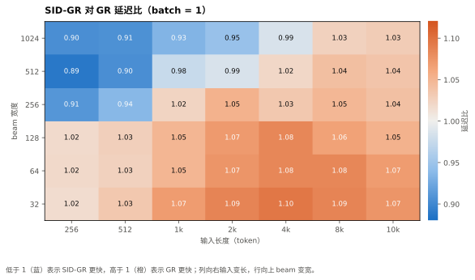
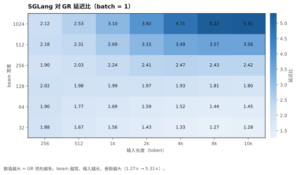
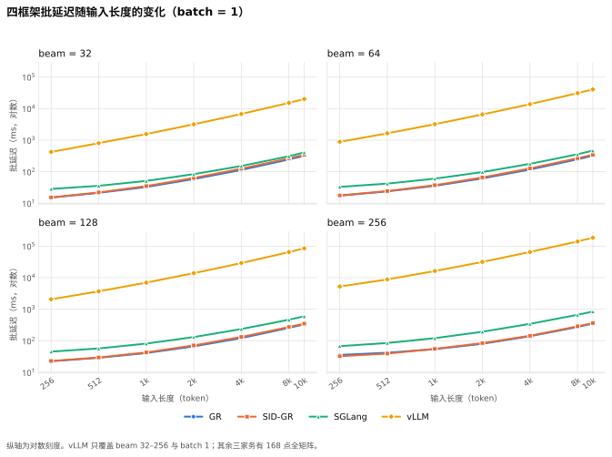

# 三框架 168 点扩展矩阵：GR / SID-GR / SGLang（H20，batch 1–8）

> 口径：BF16、TP=1、`gpu_memory_utilization=0.6`、`eos_policy=fixed3`（每序列固定 3 token，忽略 EOS）、`rounds=3` × 每轮 16 批。
> 长度 256/512/1024/2048/4096/8192/10240 × beam 32/64/128/256/512/1024 × batch 1/2/4/8 = 168 点/框架。
> GR = `vllm-gr` `decode_graph` @ `33a1fdb`；SID-GR、SGLang 使用同一容器镜像与同一套工具（vendor 补丁 `520e68c`）。

## 0. 结论

1. **GR 在三家全矩阵上中位最快**：SGLang 中位 2.08×（1.23–5.45×，168/168 点全负），SID-GR 中位 1.03×（0.89–1.10×）。
2. **SGLang 的劣势随 beam 单调放大**：W=32 1.35× → W=64 1.58× → W=128 1.95× → W=256 2.42× → W=512 3.25× → W=1024 3.96×；batch 几乎无影响（B=1 2.01× / B=2 2.01× / B=4 2.11× / B=8 2.13×）。
3. **SID-GR 与 GR 的分界是二维的**：短输入 + 宽 beam 时 SID-GR 赢（W=1024/L=256 0.90×、W=512/L=256 0.89×），长输入或窄 beam 时 GR 赢（W=32 恒 1.02–1.10×）。分界线大致是 W=256 到 L≈512、W=512 到 L≈2k、W=1024 到 L≈4k。
4. **SID-GR 的劣势有固定成分**：窄 beam 下随长度单调增大（1.02× → 1.10×），宽 beam 下基本恒定在 1.03–1.04×，说明多出来的是每请求的固定开销，而不是随序列增长的项。
5. **vLLM 实测 28 点全部完成，慢 28–529×**：按 beam 与长度单调放大，W=32 到 W=256，L=256 时 28×、L=10240 时 529×（184.9 s/批）。batch>1 与 beam 512/1024 未跑——168 点全矩阵按实测斜率外推约需 510 GPU·小时，单点最坏约 54 小时，超出 12h 墙钟上限。

## 1. 按 beam 汇总（7 长度 × 4 batch = 28 点中位数）

| beam | SGLang / GR | SID-GR / GR |
|---|---|---|
| 32 | 1.35x | 1.07x |
| 64 | 1.58x | 1.07x |
| 128 | 1.95x | 1.06x |
| 256 | 2.42x | 1.02x |
| 512 | 3.25x | 0.99x |
| 1024 | 3.96x | 0.95x |

## 2. 逐配置横向对比

### 2.1 batch = 1 的四框架横向表（42 个配置）

每行一个配置，直接横向比数值；末三列是相对 vllm-gr 的倍数。vLLM 只覆盖 batch 1 / beam 32–256，其余 126 个配置（batch 2/4/8）没有 vLLM 列，完整 168 行见 `data/wide-168.csv` 与 `03-wide-table.md`。

| 配置 | vllm-gr | sid-gr | sglang | vllm | sid-gr/gr | sglang/gr | vllm/gr |
|---|---:|---:|---:|---:|---:|---:|---:|
| bw32_in256_b1_U | 15.1 | 15.3 | 28.3 | 421.9 | 1.015 | 1.879 | 28.0 |
| bw32_in512_b1_U | 21.2 | 22.0 | 35.6 | 801.5 | 1.033 | 1.674 | 37.7 |
| bw32_in1024_b1_U | 32.6 | 34.9 | 50.9 | 1560.5 | 1.069 | 1.559 | 47.8 |
| bw32_in2048_b1_U | 58.3 | 63.3 | 83.2 | 3179.1 | 1.086 | 1.427 | 54.5 |
| bw32_in4096_b1_U | 113.5 | 124.3 | 151.4 | 6748.4 | 1.095 | 1.334 | 59.5 |
| bw32_in8192_b1_U | 244.0 | 265.0 | 308.9 | 15222.1 | 1.086 | 1.266 | 62.4 |
| bw32_in10240_b1_U | 317.3 | 340.7 | 406.9 | 20080.8 | 1.074 | 1.282 | 63.3 |
| bw64_in256_b1_U | 17.3 | 17.6 | 32.9 | 883.1 | 1.018 | 1.902 | 51.0 |
| bw64_in512_b1_U | 23.7 | 24.2 | 41.8 | 1641.3 | 1.025 | 1.765 | 69.4 |
| bw64_in1024_b1_U | 35.5 | 37.2 | 59.9 | 3204.8 | 1.049 | 1.689 | 90.3 |
| bw64_in2048_b1_U | 61.2 | 65.7 | 97.1 | 6519.6 | 1.074 | 1.587 | 106.6 |
| bw64_in4096_b1_U | 116.8 | 126.6 | 177.0 | 13823.8 | 1.084 | 1.516 | 118.4 |
| bw64_in8192_b1_U | 246.5 | 267.2 | 356.0 | 30869.6 | 1.084 | 1.444 | 125.3 |
| bw64_in10240_b1_U | 321.0 | 343.1 | 465.1 | 40767.7 | 1.069 | 1.449 | 127.0 |
| bw128_in256_b1_U | 22.4 | 22.8 | 45.2 | 2068.1 | 1.017 | 2.016 | 92.2 |
| bw128_in512_b1_U | 28.7 | 29.5 | 57.0 | 3694.7 | 1.026 | 1.983 | 128.6 |
| bw128_in1024_b1_U | 40.7 | 42.7 | 81.2 | 6984.3 | 1.048 | 1.993 | 171.5 |
| bw128_in2048_b1_U | 66.4 | 71.0 | 130.8 | 13916.5 | 1.070 | 1.971 | 209.7 |
| bw128_in4096_b1_U | 121.8 | 132.0 | 235.3 | 29108.8 | 1.084 | 1.932 | 239.0 |
| bw128_in8192_b1_U | 256.1 | 272.7 | 464.0 | 64886.5 | 1.064 | 1.812 | 253.3 |
| bw128_in10240_b1_U | 331.0 | 348.2 | 596.1 | 84948.5 | 1.052 | 1.801 | 256.6 |
| bw256_in256_b1_U | 35.4 | 32.3 | 67.4 | 5249.0 | 0.911 | 1.903 | 148.2 |
| bw256_in512_b1_U | 41.7 | 39.1 | 84.9 | 8803.1 | 0.937 | 2.034 | 211.0 |
| bw256_in1024_b1_U | 54.0 | 55.3 | 120.8 | 16267.0 | 1.023 | 2.236 | 301.1 |
| bw256_in2048_b1_U | 80.2 | 84.4 | 193.0 | 31656.3 | 1.052 | 2.407 | 394.8 |
| bw256_in4096_b1_U | 139.2 | 143.9 | 343.4 | 65323.7 | 1.033 | 2.467 | 469.2 |
| bw256_in8192_b1_U | 273.4 | 286.3 | 664.0 | 141076.7 | 1.047 | 2.428 | 516.0 |
| bw256_in10240_b1_U | 349.4 | 363.1 | 843.9 | 184932.3 | 1.039 | 2.416 | 529.3 |
| bw512_in256_b1_U | 57.3 | 50.9 | 124.8 | — | 0.888 | 2.179 | — |
| bw512_in512_b1_U | 63.9 | 57.8 | 147.7 | — | 0.905 | 2.311 | — |
| bw512_in1024_b1_U | 76.6 | 74.7 | 206.3 | — | 0.975 | 2.692 | — |
| bw512_in2048_b1_U | 103.4 | 101.9 | 325.3 | — | 0.985 | 3.146 | — |
| bw512_in4096_b1_U | 162.7 | 166.0 | 567.7 | — | 1.020 | 3.488 | — |
| bw512_in8192_b1_U | 301.1 | 313.5 | 1074.8 | — | 1.041 | 3.570 | — |
| bw512_in10240_b1_U | 378.3 | 392.0 | 1346.3 | — | 1.036 | 3.559 | — |
| bw1024_in256_b1_U | 102.8 | 92.9 | 217.8 | — | 0.904 | 2.119 | — |
| bw1024_in512_b1_U | 110.0 | 99.8 | 277.9 | — | 0.907 | 2.526 | — |
| bw1024_in1024_b1_U | 123.6 | 115.5 | 383.4 | — | 0.934 | 3.101 | — |
| bw1024_in2048_b1_U | 153.1 | 144.9 | 599.6 | — | 0.946 | 3.917 | — |
| bw1024_in4096_b1_U | 216.4 | 213.2 | 1019.7 | — | 0.985 | 4.711 | — |
| bw1024_in8192_b1_U | 362.1 | 371.2 | 1890.5 | — | 1.025 | 5.221 | — |
| bw1024_in10240_b1_U | 443.5 | 456.4 | 2356.1 | — | 1.029 | 5.312 | — |

### 2.2 按输入长度汇总（6 beam × 4 batch = 24 点中位数）

| 长度 | SGLang / GR | SID-GR / GR |
|---|---|---|
| 256 | 2.08x | 0.95x |
| 512 | 2.08x | 0.99x |
| 1k | 2.15x | 1.04x |
| 2k | 2.21x | 1.06x |
| 4k | 2.20x | 1.05x |
| 8k | 2.13x | 1.06x |
| 10k | 2.11x | 1.05x |

SGLang 对长度几乎平（2.08–2.21×），对 beam 高度敏感；SID-GR 正好相反，对长度敏感（短输入占优）而对 beam 宽容（宽 beam 占优）。

## 3. 按 batch 汇总（42 点中位数）

| batch | SGLang / GR | SID-GR / GR | SID-GR 快于 GR 的点数 |
|---|---|---|---|
| 1 | 2.01x | 1.03x | 11 / 42 |
| 2 | 2.01x | 1.04x | 13 / 42 |
| 4 | 2.11x | 1.03x | 13 / 42 |
| 8 | 2.13x | 1.04x | 13 / 42 |

合批不改变两家的相对位置，说明差异在单批内部（decode kernel / 调度），不在批间调度。

## 4. SID-GR 的二维分界（batch = 1，延迟比 SID-GR ÷ GR）

| beam \ 长度 | 256 | 512 | 1k | 2k | 4k | 8k | 10k |
|---|---|---|---|---|---|---|---|
| 1024 | **0.90** | **0.91** | **0.93** | **0.95** | **0.99** | 1.03 | 1.03 |
| 512 | **0.89** | **0.90** | **0.98** | **0.99** | 1.02 | 1.04 | 1.04 |
| 256 | **0.91** | **0.94** | 1.02 | 1.05 | 1.03 | 1.05 | 1.04 |
| 128 | 1.02 | 1.03 | 1.05 | 1.07 | 1.08 | 1.06 | 1.05 |
| 64 | 1.02 | 1.03 | 1.05 | 1.07 | 1.08 | 1.08 | 1.07 |
| 32 | 1.02 | 1.03 | 1.07 | 1.09 | 1.10 | 1.09 | 1.07 |

读数：蓝色区域（SID-GR 更快）是"decode 主导"的格子 —— 输入短意味着 prefill 占比小，beam 宽意味着 decode 的批量 GEMM 大。橙色区域是 prefill 或小批量 decode 主导的格子。

## 5. SGLang 的相对位置（batch = 1，延迟比 SGLang ÷ GR）

| beam \ 长度 | 256 | 512 | 1k | 2k | 4k | 8k | 10k |
|---|---|---|---|---|---|---|---|
| 1024 | 2.12 | 2.53 | 3.10 | 3.92 | 4.71 | 5.22 | 5.31 |
| 512 | 2.18 | 2.31 | 2.69 | 3.15 | 3.49 | 3.57 | 3.56 |
| 256 | 1.90 | 2.03 | 2.24 | 2.41 | 2.47 | 2.43 | 2.42 |
| 128 | 2.02 | 1.98 | 1.99 | 1.97 | 1.93 | 1.81 | 1.80 |
| 64 | 1.90 | 1.77 | 1.69 | 1.59 | 1.52 | 1.44 | 1.45 |
| 32 | 1.88 | 1.67 | 1.56 | 1.43 | 1.33 | 1.27 | 1.28 |

最差格子在右下角（L=10k / W=1024，5.31×），最好格子在左下角（L=10k / W=32，1.27×）。beam ≥ 512 后 SGLang 的 relative 劣势开始随长度发散发陡，与 GR 在宽 beam 上的批量 GEMM 路径相关。

## 6. batch = 1 绝对延迟（ms，42 点）

| beam | 长度 | GR | SID-GR | SGLang | SID/GR | SG/GR |
|---|---|---|---|---|---|---|
| 32 | 256 | 15.1 | 15.3 | 28.3 | 1.02x | 1.88x |
| 32 | 512 | 21.2 | 22.0 | 35.6 | 1.03x | 1.67x |
| 32 | 1k | 32.6 | 34.9 | 50.9 | 1.07x | 1.56x |
| 32 | 2k | 58.3 | 63.3 | 83.2 | 1.09x | 1.43x |
| 32 | 4k | 113.5 | 124.3 | 151.4 | 1.10x | 1.33x |
| 32 | 8k | 244.0 | 265.0 | 308.9 | 1.09x | 1.27x |
| 32 | 10k | 317.3 | 340.7 | 406.9 | 1.07x | 1.28x |
| 64 | 256 | 17.3 | 17.6 | 32.9 | 1.02x | 1.90x |
| 64 | 512 | 23.7 | 24.2 | 41.8 | 1.03x | 1.77x |
| 64 | 1k | 35.5 | 37.2 | 59.9 | 1.05x | 1.69x |
| 64 | 2k | 61.2 | 65.7 | 97.1 | 1.07x | 1.59x |
| 64 | 4k | 116.8 | 126.6 | 177.0 | 1.08x | 1.52x |
| 64 | 8k | 246.5 | 267.2 | 356.0 | 1.08x | 1.44x |
| 64 | 10k | 321.0 | 343.1 | 465.1 | 1.07x | 1.45x |
| 128 | 256 | 22.4 | 22.8 | 45.2 | 1.02x | 2.02x |
| 128 | 512 | 28.7 | 29.5 | 57.0 | 1.03x | 1.98x |
| 128 | 1k | 40.7 | 42.7 | 81.2 | 1.05x | 1.99x |
| 128 | 2k | 66.4 | 71.0 | 130.8 | 1.07x | 1.97x |
| 128 | 4k | 121.8 | 132.0 | 235.3 | 1.08x | 1.93x |
| 128 | 8k | 256.1 | 272.7 | 464.0 | 1.06x | 1.81x |
| 128 | 10k | 331.0 | 348.2 | 596.1 | 1.05x | 1.80x |
| 256 | 256 | 35.4 | 32.3 | 67.4 | 0.91x | 1.90x |
| 256 | 512 | 41.7 | 39.1 | 84.9 | 0.94x | 2.03x |
| 256 | 1k | 54.0 | 55.3 | 120.8 | 1.02x | 2.24x |
| 256 | 2k | 80.2 | 84.4 | 193.0 | 1.05x | 2.41x |
| 256 | 4k | 139.2 | 143.9 | 343.4 | 1.03x | 2.47x |
| 256 | 8k | 273.4 | 286.3 | 664.0 | 1.05x | 2.43x |
| 256 | 10k | 349.4 | 363.1 | 843.9 | 1.04x | 2.42x |
| 512 | 256 | 57.3 | 50.9 | 124.8 | 0.89x | 2.18x |
| 512 | 512 | 63.9 | 57.8 | 147.7 | 0.90x | 2.31x |
| 512 | 1k | 76.6 | 74.7 | 206.3 | 0.98x | 2.69x |
| 512 | 2k | 103.4 | 101.9 | 325.3 | 0.99x | 3.15x |
| 512 | 4k | 162.7 | 166.0 | 567.7 | 1.02x | 3.49x |
| 512 | 8k | 301.1 | 313.5 | 1074.8 | 1.04x | 3.57x |
| 512 | 10k | 378.3 | 392.0 | 1346.3 | 1.04x | 3.56x |
| 1024 | 256 | 102.8 | 92.9 | 217.8 | 0.90x | 2.12x |
| 1024 | 512 | 110.0 | 99.8 | 277.9 | 0.91x | 2.53x |
| 1024 | 1k | 123.6 | 115.5 | 383.4 | 0.93x | 3.10x |
| 1024 | 2k | 153.1 | 144.9 | 599.6 | 0.95x | 3.92x |
| 1024 | 4k | 216.4 | 213.2 | 1019.7 | 0.99x | 4.71x |
| 1024 | 8k | 362.1 | 371.2 | 1890.5 | 1.03x | 5.22x |
| 1024 | 10k | 443.5 | 456.4 | 2356.1 | 1.03x | 5.31x |

batch > 1 的全部格子见 `data/{gr,sglang,sidgr}-168.csv`。

## 7. vLLM（28 点，batch = 1）

*图 8：batch = 1，四个 beam 宽度分面，对数纵轴。vLLM 只覆盖 beam 32–256。*

| 维度 | 覆盖 | 结果 |
|---|---|---|
| beam 32/64/128 | 21 点（7 长度 × 3 beam） | 作业 `4224`，COMPLETED 05:24 |
| beam 256 | 7 点（7 长度） | 作业 `4225`，COMPLETED 06:52 |
| beam 512/1024 | 未跑 | 按实测斜率外推单点 13–54 GPU·小时，超出 12h 上限 |
| batch 2/4/8 | 未跑 | 同上，且 vLLM 的 beam 路径对 batch 维度近似线性叠加 |

延迟比 vLLM ÷ GR（同点，batch 1）：

| 长度 | W=32 | W=64 | W=128 | W=256 |
|---|---|---|---|---|
| 256 | 28x | 51x | 92x | 148x |
| 512 | 38x | 69x | 129x | 211x |
| 1k | 48x | 90x | 171x | 301x |
| 2k | 55x | 107x | 210x | 395x |
| 4k | 59x | 118x | 239x | 469x |
| 8k | 62x | 125x | 253x | 516x |
| 10k | 63x | 127x | 257x | 529x |

绝对延迟（ms，batch 1）：

| 长度 | W=32 | W=64 | W=128 | W=256 |
|---|---|---|---|---|
| 256 | 421.9 | 883.1 | 2068.1 | 5249.0 |
| 512 | 801.5 | 1641.3 | 3694.7 | 8803.1 |
| 1k | 1560.5 | 3204.8 | 6984.3 | 16267.0 |
| 2k | 3179.1 | 6519.6 | 13916.5 | 31656.3 |
| 4k | 6748.4 | 13823.8 | 29108.8 | 65323.7 |
| 8k | 15222.1 | 30869.6 | 64886.5 | 141076.7 |
| 10k | 20080.8 | 40767.7 | 84948.5 | 184932.3 |

读数：延迟对长度严格线性（翻倍即翻倍），对 beam 也近似线性，且**固定起点极高**（L=256/W=32 已经 421.9 ms，同一格 GR 是 15.1 ms）。这是原生 vLLM beam search 的 Python 层逐 beam 展开，不是融合 kernel，引用时必须带这一限定，否则会被读成"vLLM 比 GR 慢两个数量级"（虽然本矩阵下字面确实是两个数量级）。

外推关系（仅用于量级判断，不作结论）：`batch_mean_ms ≈ 4.8e-5 · L · W · B · 1000`，168 点约 510 GPU·小时。

## 8. 证据索引

| 内容 | 位置 |
|---|---|
| **合并数据（推荐入口）** | `data/all.csv` —— 532 行，`source` 列区分 `gr-168` / `sglang-168` / `sidgr-168` / `vllm-a` / `vllm-b`，其余 30 列与工具原生 `offline_summary.csv` 一致 |
| 合并脚本 | `make_all_csv.py`（新作业落地后重跑即可重建） |
| **逐配置横向对比表（推荐）** | `data/wide-168.csv` + 渲染版 `03-wide-table.md` —— 行 = 配置（`bw{beam}_in{len}_b{batch}_U`），列 = vllm-gr / sid-gr / sglang / vllm，另附三个比值列；脚本 `make_wide_table.py` |
| GR 原始数据（168 点） | `data/gr-168.csv` |
| SGLang 原始数据（168 点） | `data/sglang-168.csv` |
| SID-GR 原始数据（168 点） | `data/sidgr-168.csv` |
| GR 单框架 168 点报告 | `02-gr-single-framework.md` |
| 图 6/7 生成脚本 | `make_charts_v3.py` |
| vLLM 原始数据（28 点） | `data/vllm-a.csv`（21）、`data/vllm-b.csv`（7） |
| 作业 | GR `4151`、SID-GR `4218`、SGLang `4221`、vLLM `4224`/`4225` |
| 启动作业脚本 | `scripts/{inside.sh,submit.sbatch}` |
