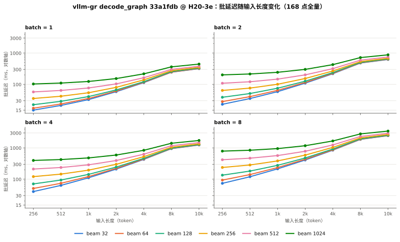
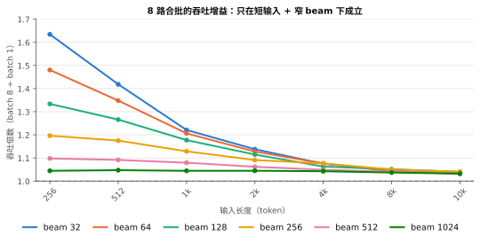
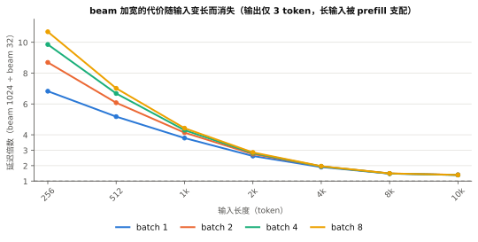

# vllm-gr decode_graph 全矩阵实测（H20-3e，2026-10-31）

## 0. 运行身份

| 项 | 值 |
|---|---|
| 代码 | vllm-gr `decode_graph` @ `33a1fdb2e39dea9e30f648405bd263eb62b15323` |
| 硬件 | NVIDIA H20-3e，143771 MiB，TP=1 |
| 容器 | `images/gr-decode-2a598ffa-vllm0221.sqsh`（torch 2.11.0+cu130，vllm 0.22.1） |
| 作业 | Slurm `h20` 分区，job **4151**，节点 `vllm-sgp-h20-05` |
| 实际耗时 | **01:35:05**（12 h 配额） |
| 点数 | **168 / 168 完成，0 失败** |
| 输入长度 | 256 / 512 / 1024 / 2048 / 4096 / 8192 / 10240 |
| beam 宽度 | 32 / 64 / 128 / 256 / 512 / 1024 |
| batch | 1 / 2 / 4 / 8 |
| 模式 | U（`gr_output_mode=auto`，`gr_prefill_fa=inherit`） |
| 采样 | `rounds=3 × batches_per_round=16`，warmup 6 批（上限 30），`eos_policy=fixed3`（每序列固定 3 token，忽略 EOS） |
| 显存 | `gpu_memory_utilization=0.6` |
| 工具 | `gpu_competitors` @ `600d8035` + 本机 vendor 版 `520e68c`（见 §5.2） |
| 数据 | `data/gr-168.csv`（168 行）；原始产物在服务器 `results/gr-wb168-h20-20261031-33a1fdb-r1/run/` |

指标口径：`batch_mean_ms` = **一次 forward 处理整批请求的耗时**（批延迟，非单请求延迟）。
`measured_requests` = 48 / 96 / 192 / 384，分别对应 batch 1 / 2 / 4 / 8（3 轮 × 16 批 × batch）。
全部 168 点 `k == beam`、`status = complete`、输出结构校验通过。

---

## 1. 结论摘要

1. **延迟随输入长度亚线性增长**：长度指数 0.40–0.96（10k/256 = 40 倍输入，延迟只涨 4.3–33 倍），并非纯 prefill 线性。beam 越宽指数越低（W=32 时 0.84，W=1024 时 0.40）。
2. **beam 加宽的代价在长输入下几乎消失**：W 32→1024 的延迟倍数从短输入 **6.83×（batch 1）/ 10.68×（batch 8）** 降到 10k 的 **1.40×**（四个 batch 完全一致）。原因是输出只有 3 个 token，10k 输入时 prefill 支配总时间。
3. **合批收益只在小输入 + 窄 beam 成立**：batch 8 相对 batch 1 的吞吐增益从 **1.63×（256 token / W=32）** 单调衰减到 **1.03×（10k 或 W≥512）**。
4. **单请求延迟在窄 beam 短输入下被合批反超**：256 token / W=32 时每请求 15.1 ms（B=1）→ 9.2 ms（B=8），合批摊掉了固定开销；W=1024 时几乎不变（102.8 → 98.4 ms）。
5. **长输入的边际成本约 36–40 µs/token/seq**，且与 batch 无关（B=1 与 B=8 差异 <2%），与 beam 弱相关（W=32 0.036 ms，W=1024 0.040 ms）→ 长输入段是算力饱和的 prefill，加 batch 或加 beam 都不省钱。

---

## 2. 全量结果

批延迟 `batch_mean_ms`（ms），行为输入长度，列为 beam 宽度。

### batch = 1

| 长度 \ beam | 32 | 64 | 128 | 256 | 512 | 1024 |
|---|---|---|---|---|---|---|
| 256 | 15.1 | 17.3 | 22.4 | 35.4 | 57.3 | 102.8 |
| 512 | 21.2 | 23.7 | 28.7 | 41.7 | 63.9 | 110.0 |
| 1024 | 32.6 | 35.5 | 40.7 | 54.0 | 76.6 | 123.6 |
| 2048 | 58.3 | 61.2 | 66.4 | 80.2 | 103.4 | 153.1 |
| 4096 | 113.5 | 116.8 | 121.8 | 139.2 | 162.7 | 216.4 |
| 8192 | 244.0 | 246.5 | 256.1 | 273.4 | 301.1 | 362.1 |
| 10240 | 317.3 | 321.0 | 331.0 | 349.4 | 378.3 | 443.5 |

### batch = 2

| 长度 \ beam | 32 | 64 | 128 | 256 | 512 | 1024 |
|---|---|---|---|---|---|---|
| 256 | 23.1 | 28.2 | 38.7 | 64.0 | 108.5 | 200.6 |
| 512 | 35.3 | 40.5 | 50.9 | 76.0 | 121.0 | 214.3 |
| 1024 | 58.5 | 64.5 | 75.2 | 100.7 | 146.9 | 242.2 |
| 2048 | 109.3 | 115.2 | 126.3 | 153.7 | 200.8 | 300.7 |
| 4096 | 218.2 | 225.2 | 237.5 | 267.4 | 317.1 | 426.2 |
| 8192 | 479.5 | 487.4 | 501.7 | 532.8 | 593.4 | 715.7 |
| 10240 | 623.7 | 632.2 | 648.6 | 680.3 | 744.6 | 876.3 |

### batch = 4

| 长度 \ beam | 32 | 64 | 128 | 256 | 512 | 1024 |
|---|---|---|---|---|---|---|
| 256 | 40.3 | 50.6 | 70.7 | 120.9 | 210.9 | 397.0 |
| 512 | 63.4 | 74.0 | 94.1 | 145.2 | 236.1 | 423.6 |
| 1024 | 111.1 | 121.5 | 142.5 | 194.6 | 287.5 | 477.8 |
| 2048 | 210.0 | 222.0 | 243.5 | 298.7 | 394.3 | 590.9 |
| 4096 | 429.0 | 442.2 | 463.5 | 523.7 | 627.8 | 836.7 |
| 8192 | 944.8 | 958.4 | 984.6 | 1050.2 | 1173.0 | 1404.8 |
| 10240 | 1235.3 | 1251.0 | 1279.3 | 1348.6 | 1479.2 | 1723.6 |

### batch = 8

| 长度 \ beam | 32 | 64 | 128 | 256 | 512 | 1024 |
|---|---|---|---|---|---|---|
| 256 | 73.7 | 93.6 | 134.5 | 236.9 | 417.5 | 787.1 |
| 512 | 119.8 | 140.4 | 181.6 | 284.0 | 468.4 | 840.7 |
| 1024 | 213.8 | 235.3 | 276.8 | 383.0 | 567.9 | 947.0 |
| 2048 | 410.1 | 434.1 | 476.3 | 587.9 | 778.9 | 1172.2 |
| 4096 | 844.8 | 867.9 | 916.8 | 1034.7 | 1241.2 | 1660.8 |
| 8192 | 1866.0 | 1892.2 | 1949.4 | 2083.0 | 2315.0 | 2793.1 |
| 10240 | 2457.2 | 2485.8 | 2546.1 | 2686.7 | 2932.7 | 3437.5 |

极值：最快 `256 / 32 / 1` = 15.1 ms；最慢 `10240 / 1024 / 8` = 3437.5 ms（227×）。

---

## 3. 图



*图 3：四个 batch 各一版面，6 条线为 beam 宽度，纵轴对数。宽 beam 在短输入处整体抬高，在 10k 处被其他曲线收敛吃掉。*



*图 4：batch 8 相对 batch 1 的吞吐倍数。W=32 从 1.63× 跌到 1.03×；W=1024 全程 ≈1.04×。*



*图 5：W 1024 ÷ W 32 的延迟倍数。短输入放大到 6.8–10.7×，4k 起收敛，10k 时四个 batch 都是 1.40×。*

---

## 4. 分析

### 4.1 长度标度不是线性的

对 256→10240 做双对数拟合，得到长度指数：

| batch | W=32 | W=64 | W=128 | W=256 | W=512 | W=1024 |
|---|---|---|---|---|---|---|
| 1 | 0.84 | 0.81 | 0.75 | 0.64 | 0.52 | 0.40 |
| 2 | 0.91 | 0.86 | 0.78 | 0.66 | 0.53 | 0.40 |
| 4 | 0.94 | 0.89 | 0.80 | 0.67 | 0.54 | 0.40 |
| 8 | 0.96 | 0.90 | 0.81 | 0.67 | 0.54 | 0.40 |

40 倍输入只涨 4.3×（W=1024 / B=1）到 33.3×（W=32 / B=8）。指数随 beam 变宽而降低，说明**固定开销（3 步 decode + 图执行/调度）在短输入和宽 beam 下占比很大**，被长度增长摊薄后才露出 prefill 的真实斜率。这与「beam 只在 decode 上花钱」的预期一致。

### 4.2 beam 的代价集中在 decode，且 decode 只有 3 步

W 32→1024 的延迟倍数：

| 长度 | batch 1 | batch 2 | batch 4 | batch 8 |
|---|---|---|---|---|
| 256 | 6.83× | 8.69× | 9.86× | 10.68× |
| 512 | 5.18× | 6.08× | 6.68× | 7.02× |
| 1024 | 3.79× | 4.14× | 4.30× | 4.43× |
| 2048 | 2.62× | 2.75× | 2.81× | 2.86× |
| 4096 | 1.91× | 1.95× | 1.95× | 1.97× |
| 8192 | 1.48× | 1.49× | 1.49× | 1.50× |
| 10240 | 1.40× | 1.40× | 1.40× | 1.40× |

两个非直觉点：

- **短输入下合批会放大 beam 代价**（6.83× → 10.68×）。宽 beam 的落选候选填充/排序在批内并行反而更容易打满 SM，此时合批没有剩下可摊的固定开销。
- **长输入下四个 batch 的倍数完全一致（1.40×）**。输出 `fixed3` 只有 3 个 token，10k 输入时 3 步 decode 的绝对时间被 prefill 淹没，beam 宽度退化成统计噪声。

### 4.3 合批的真实收益

吞吐（req/s）与每请求延迟：

| 场景 | 吞吐 B=1 | 吞吐 B=8 | 增益 | 每请求 ms B=1 | 每请求 ms B=8 |
|---|---|---|---|---|---|
| 256 / W=32 | 66.4 | 108.6 | **1.63×** | 15.1 | 9.2 |
| 256 / W=1024 | 9.7 | 10.2 | 1.04× | 102.8 | 98.4 |
| 10240 / W=32 | 3.15 | 3.26 | 1.03× | 317.3 | 307.2 |
| 10240 / W=1024 | 2.25 | 2.33 | 1.03× | 443.5 | 429.7 |

合批只在「计算没饱和」时有收益：短输入 + 窄 beam 时单请求 15.1→9.2 ms（−39%），而宽 beam 或长输入时已经算力饱和，8 倍 batch 只换 3% 吞吐。

### 4.4 长输入的边际成本

用 8192→10240 差分得到每 token 每序列成本：

| batch | W=32 | W=256 | W=1024 |
|---|---|---|---|
| 1 | 0.0358 ms | 0.0371 ms | 0.0398 ms |
| 8 | 0.0361 ms | 0.0368 ms | 0.0393 ms |

~36–40 µs/token/seq，**与 batch 无关、与 beam 弱相关**。这是 H20 上 prefill GEMM 已接近算力上限的信号：长输入场景下，调 batch 或调 beam 都不能改善吞吐，只能靠更便宜的前缀计算。

> 注：此值（36–40 µs）与本仓早期记录的 27.9 µs/token 口径不同——后者是单请求 prefill 阶段的内部计时，此处是从批延迟差分推得的**含全部阶段开销**的外沿成本，且代码基线已从 10 月中的 commit 前进到 `33a1fdb`。两者不可直接比较。

---

## 5. 未覆盖项与原因

### 5.1 batch = 16：vllm-gr 硬性不支持

`vllm_gr/config/models.py:33` 定义 `SUPPORTED_BEAM_BATCH_SIZES = tuple(range(1, 9))`，请求校验层直接拒绝：

```
BeamSearchRequestError: beam_search_v1 supports batch sizes (1, 2, 3, 4, 5, 6, 7, 8), got 16
```

（job 4143 实测，beam 512 组引擎初始化正常后在此处失败。）要覆盖 batch 16 必须改产品代码扩大该常量并验证 kernel/图捕获，属于独立决策，本次未做。

### 5.2 beam > 256：公共评测工具需要补丁

公共工具 `competitor-suite-600d8035` 的 GR adapter 写死：

```python
if self.gr and point["beam"] > 256:
    raise Unsupported("this adapter currently validates GR beam widths up to 256; ...")
```

本次在服务器上 vendor 了一份到 `~/DingYi/tools/competitor-suite-600d8035-wb1024`（commit `520e68c`），只改两处：

1. 上限 `256 → 1024`（对齐 vllm-gr 的 `MAX_BEAM_WIDTH`）；
2. GR 配置补 `candidate_width = min(beam, 256)` —— 因为 `beam_max_width > MAX_CANDIDATE_WIDTH(256)` 时 vllm-gr 要求显式给出每行候选数，K 保持 256、行数等于 beam。

只读原件 `600d8035` 未改动，`inside.sh` 里断言 vendor 版 HEAD == `520e68c` 且工作区干净。

### 5.3 早期两次 W=1024 失败是预热预算不足，不是缺陷

| 作业 | 配置 | 结果 |
|---|---|---|
| 4143 | W∈{512,1024}×B∈{1,16} | W=512 引擎正常但 batch 16 被拒；W=1024 + batch 16 在 `_dummy_sampler_run` 触发 CUDA illegal memory access |
| 4148 | W=1024×B=1，`max_warmup_batches=6` | `RuntimeError: warmup did not stabilize within the frozen budget` |
| 4149 | W=1024×B∈{1,8}，`max_warmup_batches=30` | **complete**，102.6 ms / 786.6 ms |

结论：W=1024 在 batch ≤ 8 下正常。4143 的 CUDA 非法访存在 batch 16（`max_num_seqs = 16×1024 = 16384`）下出现，由于 batch 16 本身已被拒绝，不再深究；若后续要开 batch 16，这是已知要一起排查的点。

### 5.4 一条非致命告警

新 commit 下引擎日志出现：`vllm_gr: prefix calibration skipped (segment layout needs 648 pages but the block table only holds 641)`。未影响任何测点完成，未计入结论，留待后续确认是否影响前缀命中路径。

---

## 6. 证据索引

| 内容 | 位置 |
|---|---|
| 168 点汇总 CSV | `data/gr-168.csv`（本目录）；四家合并版见 `data/all.csv`（`source == "gr-168"`） |
| 服务器原始产物 | `~/DingYi/results/gr-wb168-h20-20261031-33a1fdb-r1/run/`（含 `offline_measurements.csv`、每组 `point.json`、`preview.json`、`report_zh.md`） |
| 作业日志 | `~/DingYi/logs/gr-wb168-4151.out` |
| 运行配置 | `~/DingYi/configs/gr-wb1024-full-h20-20261031-33a1fdb-r1.json`（本机副本 `gr-wb1024/config-full-v3.json`） |
| 容器启动脚本 | `scripts/submit.sbatch`、`scripts/inside.sh` |
| 工具补丁 | `gr-wb1024/patch_adapter.py`；服务器 vendor 版 commit `520e68c` |
| 出图脚本 | `make_charts_v2.py` → `figs/fig3..fig5` |
| Slurm 记录 | `sacct -j 4151` → `COMPLETED`，`Elapsed 01:35:05` |
