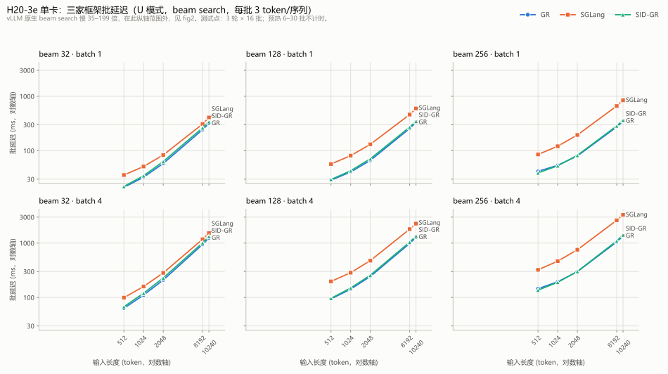
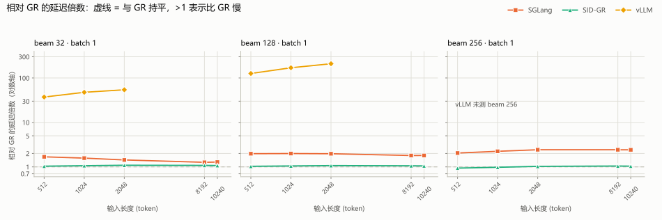

# H20 四框架离线推理性能汇总（GR / SGLang / SID-GR / vLLM）

日期：2026-10-31 汇总。设备：NVIDIA H20-3e 单卡（TP=1）。工具：`competitor-suite-600d8035`（提交 `600d8035`）。矩阵：U 模式（不约束词表）× 长度 `[512, 1024, 2048, 8192, 10240]` × beam `[32, 128, 256]` × batch `[1, 2, 4]`，每点 3 轮 × 16 批，预热 6–30 批不计时，`fixed3`（每序列恰出 3 token、忽略 EOS），BF16。

**指标口径**：表内数字是**批延迟 ms**（一整批请求完成的时间），越低越好。同 batch 下即可直接比大小。

---

## 0. GR 列的版本

| 项 | 值 |
| --- | --- |
| GR 代码 | `decode_graph` @ `33a1fdb2e39dea9e30f648405bd263eb62b15323` |
| GR 数据采集时间 | **2026-10-31**，作业 `4151`，20:59 → 22:34 |
| GR 整轮耗时 | **01:35:05**（168/168 点 U 模式；本文取其与其余三家重合的 45 点） |
| 与上一版（10-29 作业 `3476`，commit 更早）相比 | 45 个重合点**全部更快**：中位 **−11.8%**，最大 −28.2% |
| 状态 | 已推进到最新 `decode_graph`。后续 PR 若合入，GR 仍可能再快，届时比例会继续变大 |

其余三家数据采集于 2026-10-31：SGLang 作业 `3972`（31:04）、SID-GR 作业 `3973`（18:12）、vLLM 作业 `3991`（1:27:42）。GR 与它们同日，但不同作业窗口。

GR 的完整 168 点扩展矩阵（含 beam 512/1024、长度 256/4096、batch 8）见 `02-gr-single-framework.md`。

**SGLang 与 SID-GR 也已补齐同一套 168 点**（作业 `4221` / `4218`，168/168 complete），vLLM 因单点成本过高只跑了 28 点（batch 1，beam 32–256）。三家全矩阵 + vLLM 部分点的对比与比值热图见 `01-four-framework-matrix.md`；本文 §5.1/§5.2/§5.3 已按新口径改写，§2/§3 的主表仍是四家都可比的 45 点交集。四份数据已合并为 `data/all.csv`（532 行）。

---

## 1. 对比图

*图 1：GR / SGLang / SID-GR 在 beam × batch 六种组合下随输入长度的变化（对数纵轴）。vLLM 因慢 37–224 倍超出纵轴范围，见图 2。*

*图 2：各框架延迟 ÷ GR 同点延迟（batch=1，对数纵轴）。虚线 = 1.0，即与 GR 持平；线上方 = 比 GR 慢。vLLM 只测了 beam 32/128、L ≤ 2048。*

---

## 2. 主表：45 个配置点的批延迟（ms）

`—` = 该点未实测（vLLM 只跑了 12 点子矩阵，其余留空，不做外推）。

| 输入token | Beam | Batch | GR/ms 10-31 · 1:35 · 33a1fdb | SGLang/ms 10-31 | SID-GR/ms 10-31 | vLLM/ms 10-31 |
| ---: | ---: | ---: | ---: | ---: | ---: | ---: |
| 512 | 32 | 1 | 21 | 36 | 22 | 791 |
| 512 | 32 | 2 | 35 | 56 | 37 | 1567 |
| 512 | 32 | 4 | 63 | 100 | 68 | — |
| 512 | 128 | 1 | 29 | 57 | 30 | 3624 |
| 512 | 128 | 2 | 51 | 99 | 52 | 7275 |
| 512 | 128 | 4 | 94 | 197 | 97 | — |
| 512 | 256 | 1 | 42 | 85 | 39 | — |
| 512 | 256 | 2 | 76 | 170 | 71 | — |
| 512 | 256 | 4 | 145 | 323 | 136 | — |
| 1024 | 32 | 1 | 33 | 51 | 35 | 1553 |
| 1024 | 32 | 2 | 59 | 86 | 63 | 3100 |
| 1024 | 32 | 4 | 111 | 160 | 120 | — |
| 1024 | 128 | 1 | 41 | 81 | 43 | 6913 |
| 1024 | 128 | 2 | 75 | 147 | 79 | 14116 |
| 1024 | 128 | 4 | 142 | 286 | 149 | — |
| 1024 | 256 | 1 | 54 | 121 | 53 | — |
| 1024 | 256 | 2 | 101 | 233 | 98 | — |
| 1024 | 256 | 4 | 195 | 466 | 190 | — |
| 2048 | 32 | 1 | 58 | 84 | 63 | 3163 |
| 2048 | 32 | 2 | 109 | 149 | 120 | 6329 |
| 2048 | 32 | 4 | 210 | 284 | 229 | — |
| 2048 | 128 | 1 | 66 | 131 | 71 | 13885 |
| 2048 | 128 | 2 | 126 | 244 | 135 | 28280 |
| 2048 | 128 | 4 | 244 | 476 | 257 | — |
| 2048 | 256 | 1 | 80 | 195 | 82 | — |
| 2048 | 256 | 2 | 154 | 383 | 158 | — |
| 2048 | 256 | 4 | 299 | 754 | 301 | — |
| 8192 | 32 | 1 | 244 | 309 | 264 | — |
| 8192 | 32 | 2 | 480 | 594 | 514 | — |
| 8192 | 32 | 4 | 945 | 1177 | 1011 | — |
| 8192 | 128 | 1 | 256 | 462 | 271 | — |
| 8192 | 128 | 2 | 502 | 902 | 529 | — |
| 8192 | 128 | 4 | 985 | 1807 | 1041 | — |
| 8192 | 256 | 1 | 273 | 663 | 286 | — |
| 8192 | 256 | 2 | 533 | 1312 | 556 | — |
| 8192 | 256 | 4 | 1050 | 2621 | 1095 | — |
| 10240 | 32 | 1 | 317 | 407 | 341 | — |
| 10240 | 32 | 2 | 624 | 776 | 667 | — |
| 10240 | 32 | 4 | 1235 | 1527 | 1321 | — |
| 10240 | 128 | 1 | 331 | 597 | 348 | — |
| 10240 | 128 | 2 | 649 | 1152 | 682 | — |
| 10240 | 128 | 4 | 1279 | 2279 | 1353 | — |
| 10240 | 256 | 1 | 349 | 844 | 363 | — |
| 10240 | 256 | 2 | 680 | 1662 | 712 | — |
| 10240 | 256 | 4 | 1349 | 3301 | 1412 | — |

## 3. 同一张表的比值版（各框架 / GR）

`>1` = 比 GR 慢，`<1` = 比 GR 快。

| 输入token | Beam | Batch | GR ms | SGLang/GR | SID-GR/GR | vLLM/GR |
| ---: | ---: | ---: | ---: | ---: | ---: | ---: |
| 512 | 32 | 1 | 21.2 | 1.68x | 1.04x | 37.23x |
| 512 | 32 | 2 | 35.3 | 1.60x | 1.06x | 44.44x |
| 512 | 128 | 1 | 28.7 | 1.98x | 1.03x | 126.09x |
| 512 | 128 | 2 | 50.9 | 1.94x | 1.02x | 142.84x |
| 512 | 256 | 1 | 41.7 | 2.05x | 0.94x | — |
| 512 | 256 | 2 | 76.0 | 2.23x | 0.94x | — |
| 1024 | 32 | 1 | 32.6 | 1.57x | 1.06x | 47.61x |
| 1024 | 32 | 2 | 58.5 | 1.48x | 1.08x | 52.99x |
| 1024 | 128 | 1 | 40.7 | 1.99x | 1.05x | 169.72x |
| 1024 | 128 | 2 | 75.2 | 1.96x | 1.05x | 187.68x |
| 1024 | 256 | 1 | 54.0 | 2.24x | 0.98x | — |
| 1024 | 256 | 2 | 100.7 | 2.31x | 0.98x | — |
| 2048 | 32 | 1 | 58.3 | 1.43x | 1.09x | 54.23x |
| 2048 | 32 | 2 | 109.3 | 1.36x | 1.10x | 57.91x |
| 2048 | 128 | 1 | 66.4 | 1.97x | 1.07x | 209.22x |
| 2048 | 128 | 2 | 126.3 | 1.93x | 1.07x | 223.96x |
| 2048 | 256 | 1 | 80.2 | 2.43x | 1.03x | — |
| 2048 | 256 | 2 | 153.7 | 2.49x | 1.03x | — |
| 8192 | 32 | 1 | 244.0 | 1.27x | 1.08x | — |
| 8192 | 128 | 1 | 256.1 | 1.80x | 1.06x | — |
| 8192 | 256 | 1 | 273.4 | 2.42x | 1.04x | — |
| 10240 | 32 | 1 | 317.3 | 1.28x | 1.07x | — |
| 10240 | 128 | 1 | 331.0 | 1.80x | 1.05x | — |
| 10240 | 256 | 1 | 349.4 | 2.42x | 1.04x | — |

上表为 batch=1 摘要；batch=2/4 的比值与 batch=1 同向，完整 45 行比值见第 2 节原始延迟（分子分母同 batch 直接相除）。

**分组中位数：**

| 维度 | SGLang/GR | SID-GR/GR | vLLM/GR |
| --- | ---: | ---: | ---: |
| beam 32 | 1.36x | 1.07x | 50.30x |
| beam 128 | 1.94x | 1.05x | 178.70x |
| beam 256 | 2.42x | 1.03x | 未测 |
| L512 | 1.98x | 1.03x | 85.27x |
| L10240 | 1.78x | 1.05x | 未测 |
| **全部实测点** | **1.94x**（1.24–2.53） | **1.05x**（0.94–1.10） | **92.00x**（37.2–224.0） |

## 4. 资源与启动开销

| 框架 | 引擎启动（秒，按 beam 组） | 峰值显存（GiB） | 说明 |
| --- | --- | ---: | --- |
| GR | 101.4 / 103.7 / 105.0 | 85.7–91.1 | 按 `gpu_memory_utilization=0.6` 预分配 KV 池 |
| SGLang 0.5.22 | 88.3 / 90.1 / 94.1 | 85.8–88.2 | 同上 |
| SID-GR 0.1.0 | 22.4 / 22.5 / 27.1 | 9.2–39.9 | 不预分配 KV 池，按需增长 |
| vLLM 0.32.0 | 104.3 / 206.4 | 82.8–87.4 | 只初始化了 beam 32/128 两组 |

显存**不可横向比较**：GR/SGLang/vLLM 都预分配到约 86 GiB，SID-GR 按需分配。这个差异同时意味着 SID-GR 的延迟优势不能全归因于算法。

---

## 5. 实验分析

**5.1 GR 对 SGLang：优势随 beam 宽度单调放大，与长度基本无关。**（下表来自 168 点全矩阵，详见 `01-four-framework-matrix.md`）

- beam 32 → 1.35x，64 → 1.58x，128 → 1.95x，256 → 2.42x，512 → 3.25x，1024 → **3.96x**。beam 涨 32 倍，GR 的相对优势涨 2.9 倍，说明 SGLang 的 beam 扩展成本更高（beam 内候选管理/调度开销更大），GR 的分级 beam 路径更贴合这个场景。
- 各长度下的中位比值在 2.08–2.21x 之间（L256 2.08x、L2048 2.21x、L10k 2.11x）。**GR 的优势不是"长序列才体现"，而是一个恒定的结构优势**，短序列场景同样成立。
- batch 几乎不影响相对位置（B=1 2.01x、B=8 2.13x），差异在单批内部而非批间调度。
- 单点范围 1.23x（10240/32/B8）到 5.45x（10240/1024/B8）：窄 beam + 长输入是 GR 领先最少的一档，宽 beam + 中长输入领先最多。

**5.2 GR 对 SID-GR：整体 1.03x，但分界是二维的，宽 beam 下 SID-GR 反超。**

- 168 点中位 1.03x，范围 0.89–1.10x，SID-GR 在 50/168 个格子里更快（batch 1 时 11/42，batch 2/4/8 各 13/42）。
- **交叉线**：SID-GR 赢的是"decode 主导"的格子 —— W=1024 时 L≤4k 全赢（0.90→0.99x），W=512 时 L≤2k 赢（0.89→0.99x），W=256 时 L≤512 赢（0.91/0.94x）；进入 W≤128 后一律落后（1.02–1.08x）。
- 按 beam 看比值单调下降：W=32 1.07x、128 1.06x、256 1.02x、**512 0.99x、1024 0.95x**——上一版只看 beam ≤256 的矩阵把这条反转趋势截断了，才得出"没有任何一档稳定领先"的结论。
- 按长度看 SID-GR 的劣势有固定成分：L256 0.95x（整体还快）、L2048 1.06x、L10k 1.05x，说明多出来的是每请求的固定开销，不随序列增长。
- 上一版 GR（10-29 提交）时 SID-GR 整体曾快 5%（0.95x），这一优势在新 `decode_graph` 下已经消失——**它的"优势"本质上是 GR 当时更慢，不是 SID-GR 走得更快。** SID-GR 用 BF16 Torch SDPA prefill + 自带 `corelib/gr_decode_atten` decode，与 GR 不是同一套 kernel 栈。

**5.3 vLLM 的 28–529 倍不是"vLLM 的 decode 能力"。**（下表来自 batch=1 的 28 点实测，作业 `4224`/`4225`）

- 这个差距来自**原生 vLLM beam search 路径**：`BeamSearchParams` 在 Python 层逐 beam、逐 token 展开，不是融合 kernel。引用时必须带这句限定，否则会被读成"vLLM 的 GPU 能力差两个数量级"。
- 且它同时随 beam 与长度恶化：L=256 时 W=32 28x → W=256 148x（beam 涨 8 倍，比值涨 5.3 倍）；W=32 时 L=256 28x → L=10240 63x。绝对延迟对长度严格线性（W=256：5249 → 184932 ms），起点就高（L=256/W=32 已是 421.9 ms，同格 GR 15.1 ms）。
- beam 512/1024 与 batch>1 未跑：按实测斜率外推单点 13–54 GPU·小时，168 点约 510 GPU·小时，超出 12h 墙钟上限。

**5.4 三者（含 GR）共同的缩放律（对容量规划有用）。**

- **长度**：token 数涨 20 倍（512→10240），GR 延迟只涨 14.9 倍（21.2→317.3 @ W32/B1）。固定开销（launch、调度）被摊薄，边际成本低于线性。
- **batch**：batch 1→4（4 倍工作量），GR 延迟只涨 2.98 倍（21.2→63.4 @ L512/W32）。合批确实有效，但边际收益递减，说明瓶颈已经偏向算力而非调度。
- **beam**：三家都是次线性。GR 在 L512/B1 上 beam 32→128（4 倍宽）延迟只涨 1.35 倍（21.2→28.7 ms），128→256（2 倍宽）涨 1.45 倍；SGLang 对应为 1.59× / 1.50×，SID-GR 为 1.34× / 1.32×。**beam 扩展本身不是瓶颈，差距来自每一步的绝对开销**，这解释了为什么 GR 对 SGLang 的优势随 beam 单调放大（1.36→1.94→2.42x）。

**5.5 GR 已经领先不动的地方。**

- 短序列 + 小 beam（512/32/1）：GR 21.2 ms vs SID-GR 22.0 ms，差距 3.7%。这一格已经接近 GPU 上"3 个 token × 32 beam"的下限，优化空间主要不在这里。
- 长序列 + 小 beam（10240/32/1）：GR 只领先 SGLang 1.28x（317.3 vs 407.4），是全部 45 点里相对优势最小的一档——prefill 主导时各家差距最小。

---

## 6. 口径与差异披露

引用任何数字前必须同时说明以下几条：

1. **GR 是 10-31 的 `decode_graph` @ `33a1fdb` 数据**，已是当前最新分支；若后续 PR 再合入，GR 仍可能更快，本文 GR 数字仍应视为下界。
2. **同日不同窗口**：四家均为 10-31，但 GR 为作业 `4151`，其余三家为 `3972`/`3973`/`3991`。工具提交、模型、输入 bundle、矩阵、轮次、计时边界、`gpu_memory_utilization=0.6` 全部一致；节点与共租户（同一张卡上的其他作业）状态未必相同。
3. **torch 版本四条不同**：GR 2.11.0+cu130 / SGLang 2.14.1+cu130 / SID-GR 2.9.1+cu130 / vLLM 2.13.0+cu130。
4. **SID-GR 不是通用推理框架**：NVIDIA recsys-examples v26.08 的专用离线实现（commit `97062d9`），无 HTTP 服务、无在线形态。与 GR、SGLang 的产品定位不同。
5. **vLLM 矩阵不完整**：只覆盖 L ≤ 2048、W ≤ 128、B ≤ 2。L8192/10240、W256、B4 未实测，按趋势只会更差，**不做外推**。选择理由：单点 L10240/W256/B4 约需 7–8 小时，全 45 点约 48 小时，超出分区 12 小时上限。
6. **C 模式（catalog 约束）只有 GR 支持**，本轮四家统一跑 U 模式，C 模式未做横向对比。
7. **本轮不做质量评测**：只看延迟与输出结构（候选数 = beam、无重复、分数有限、每序列 3 token）。所有点 45/45、45/45、45/45、12/12 通过输出审计。
8. **本文未覆盖**：batch 8、beam 512/1024、长度 256/4096、在线并发形态、多卡 TP>1、跨请求前缀缓存（全部关闭）。其中 batch 8 与 beam 512/1024 已在 `02-gr-single-framework.md` 对 GR 单独补齐；batch 16 因 vllm-gr 硬性只支持 1–8 而未测。

其他一致性事实：SGLang 跑了两次（r1 作业 `3969` 31:56 / r2 作业 `3972` 31:04），逐点最大偏差 3.1%，无点超 5%。SID-GR 有 3 个点轮间 QPS 相对标准差 > 5%（最大 2048/256/2 = 0.402），其余点稳定；vLLM 12 点全部 ≤ 1.1%。

---

## 7. 下一步

1. **vLLM 的 168 点不可行，已跑降级版 28 点**：`4224`（beam 32/64/128 × 7 长度，21 点，5:24）与 `4225`（beam 256 × 7 长度，7 点，6:52）均 COMPLETED；余下格子（batch 2/4/8、beam 512/1024）只能按实测斜率外推，单点最坏约 54 GPU·小时。
2. **待后续 PR 合入后再刷一次 GR 列**；重跑脚本与配置已固化（`gr-wb1024/`），单次 168 点约 1.6 小时（SID-GR/SGLang 同规格）。
3. 可选：GR 与竞品在**同一作业窗口内**重跑，消除跨日与共租户两个变量。

---

## 8. 证据与复现

本文数据全部来自服务器 `~/DingYi/results/` 下的 `offline_summary.csv`，本目录 `data/` 是原件拷贝：

| 文件 | 行数 | 来源 |
| --- | ---: | --- |
| [`data/all.csv`](data/all.csv) | 532 | **合并版**：GR/SGLang/SID-GR 各 168 + vLLM 21+7，`source` 列区分，由 `make_all_csv.py` 生成 |
| [`data/wide-168.csv`](data/wide-168.csv) | 168 | **逐配置横向对比**：行 = 配置，列 = 四框架延迟 + 三个比值；渲染版见 [`03-wide-table.md`](03-wide-table.md) |
| [`data/gr-168.csv`](data/gr-168.csv) | 168 | `gr-wb168-h20-20261031-33a1fdb-r1/run/`，作业 `4151` |
| [`data/sglang-168.csv`](data/sglang-168.csv) | 168 | `sglang-wb168-h20-20261101-600d-r1/run/`，作业 `4221` |
| [`data/sidgr-168.csv`](data/sidgr-168.csv) | 168 | `sid_gr-wb168-h20-20261101-600d-r1/run/`，作业 `4218` |

45 点交集那轮的逐家明细（完整披露、输出审计、复现命令）留在服务器 `~/DingYi/results/` 的对应作业目录下，本仓只收 168 点矩阵的数据。

图：`make_charts.py` 从 `data/*.csv` 直接生成（本仓附 `make_*.py` 系列脚本，在包目录下运行即可重绘）。
